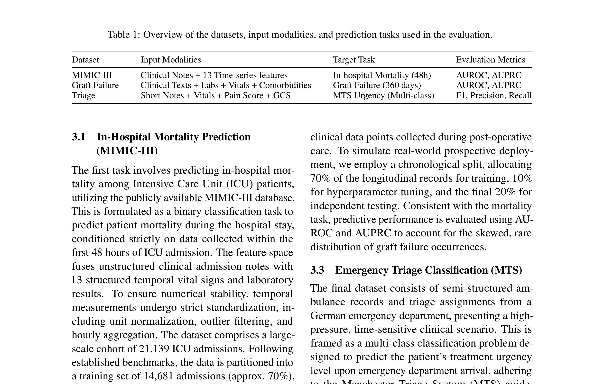
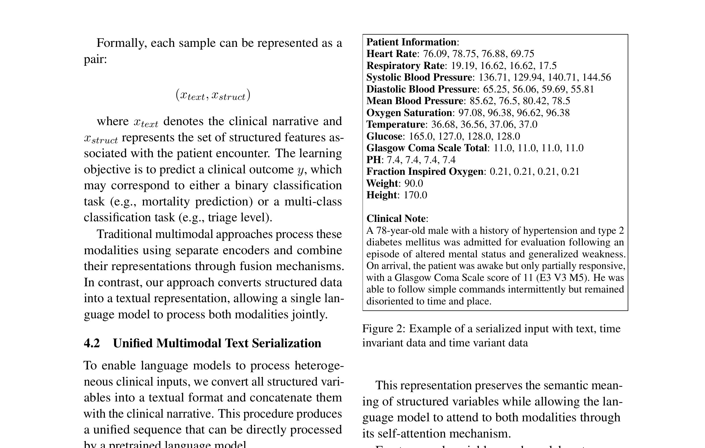
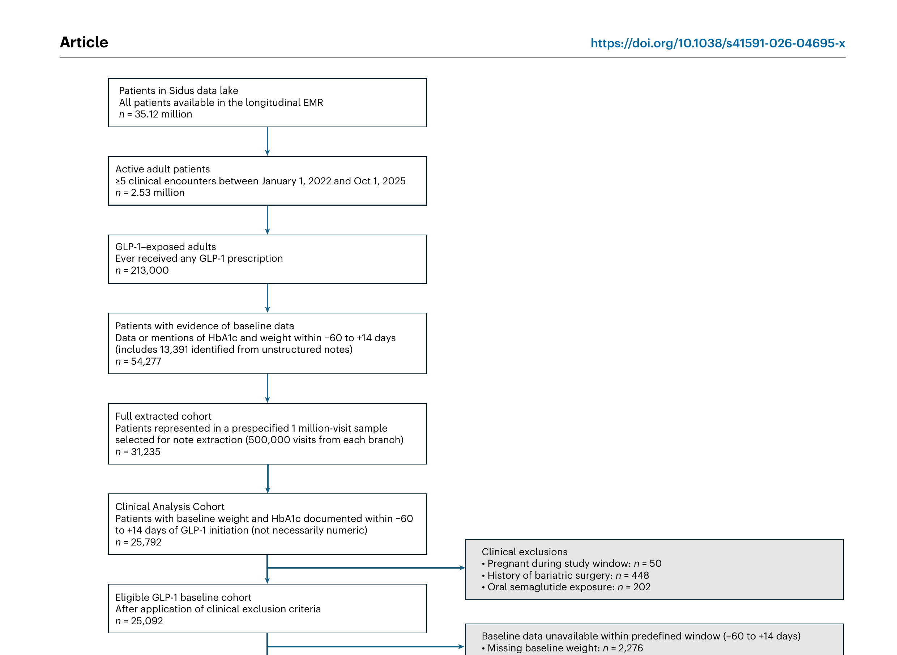
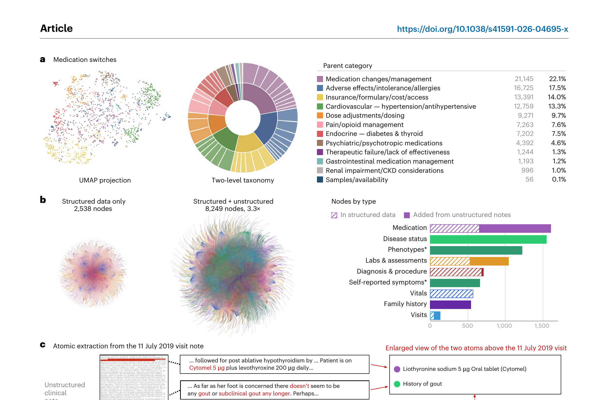
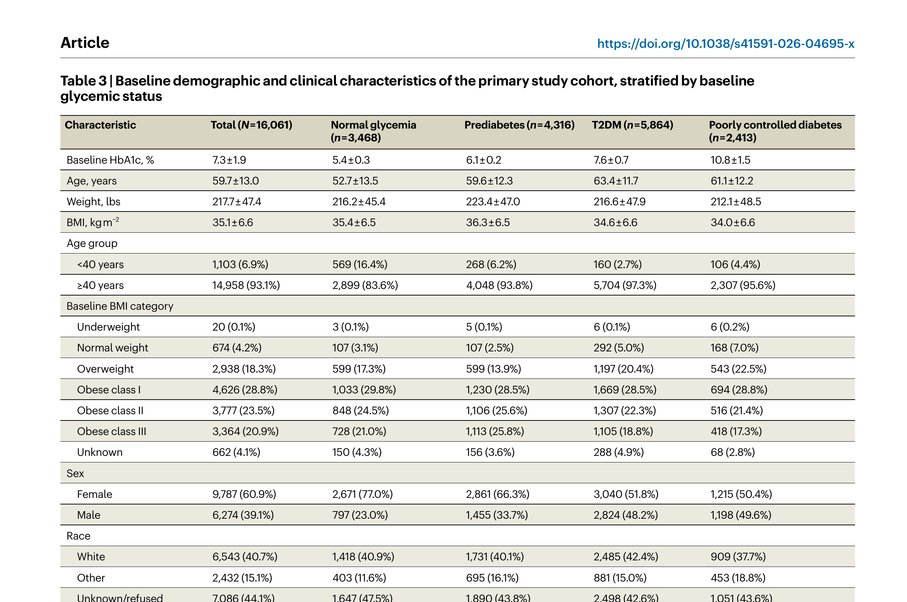
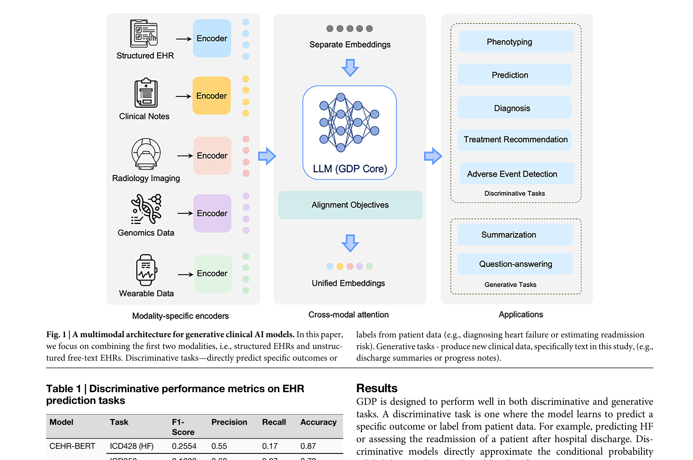
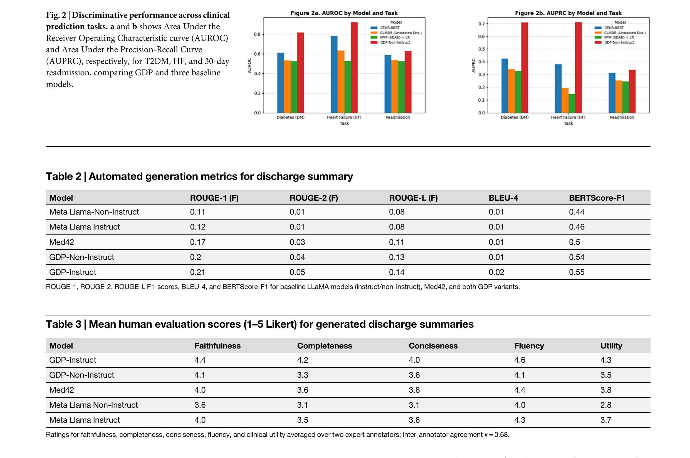
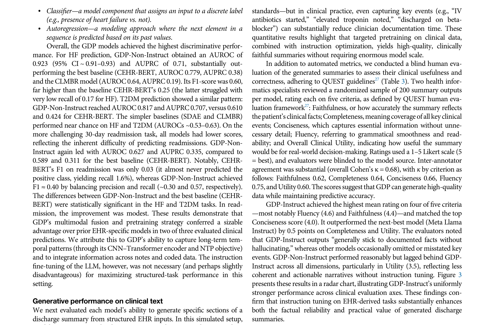
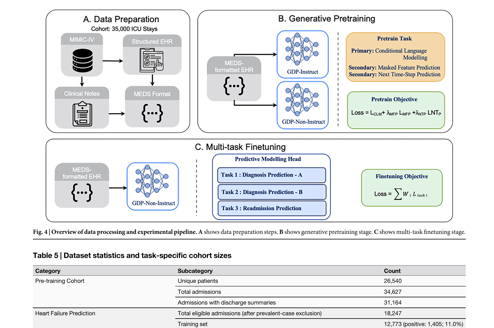

# 组会讲稿：Adaptive Temporal Semantics Learning 初步思路 + 三篇核心论文精讲

> **主题**：Task- and Patient-Conditioned Temporal Representation Learning for Asynchronous EHR
> **时长**：约 40-50 分钟
> **结构**：Idea 思路（10分钟）→ 三篇论文精讲（30分钟）→ 讨论（5-10分钟）

---

## Part 1: 我的 Idea 思路（约 10 分钟）

### 从一个临床场景说起

大家想一个 ICU 里的场景。

有两个患者，都是明天要评估死亡风险。

**患者 A**：术后恢复期，生命体征平稳，住院第 10 天。他的病房里监护仪每小时响一次，化验每 12 小时抽一次。这个患者你判断他风险高不高？大概率不高。你要判断他，你主要看什么？看过去 3 天的趋势——有没有在慢慢恢复？伤口愈合得怎么样？化验指标有没有在往好的方向走？

**患者 B**：感染性休克，住院第 2 天。血压在掉，乳酸在升，刚上了去甲肾上腺素。这个患者你看什么？你看的是过去 2-3 个小时——他刚才血压掉了多少？对升压药的反应怎么样？

同样是"预测死亡风险"，对这两个患者，你看的**时间窗口完全不同**。一个看 3 天，一个看 3 小时。

但是我们现在所有的 EHR 模型，不管你用 GRU-D、Transformer 还是 LLM，它们都只有一个固定的时间窗口。你要么看 5 小时，要么看 24 小时，对所有人一视同仁。

这就是我的出发点：**临床时间语义不是固定的，它应该随着患者状态和任务目标而变化。**

### 核心假设

我的核心假设就一句话：

> 临床时间语义不是固定的，而是随着患者状态、病程阶段和 downstream task 改变。

具体来说：

- **患者层面**：稳定 ICU 患者看 12h 历史就够了，急剧恶化的患者看 1-3h 就对了。模型应该自己学会"该看多远"。
- **任务层面**：预测死亡风险需要长期积累 + 急性恶化，预测急性恶化需要近期快速动态，预测表型需要长期疾病轨迹。不同任务需要不同的时间证据。

### 从固定窗口到自适应核

传统做法：

```
if |t_i - t_j| < 5h:    # 固定阈值
    attend(t_i, t_j)
```

所有事件在 5 小时内权重一样，5 小时外直接忽略。

我的想法是用一个自适应的高斯核：

```
σ_t = f(patient_state, task)     # 模型自己学出来的时间带宽
K(Δt) = exp(-Δt² / (2σ_t²))     # 高斯核函数
```

σ_t 是什么？就是"当前患者、当前任务下，我应该看多远以前的信息"。

- 稳定患者：σ_t = 12h，看远期趋势
- 休克患者：σ_t = 2h，看急性动态
- 预测死亡：σ_t 可能双峰（既看急性也看慢性）
- 预测表型：σ_t = 24h，看长期轨迹

### 三个研究问题

| RQ | 问题 | 我要证明什么 |
|----|------|------------|
| RQ1 | 固定时间粒度是否限制了 EHR 表征？ | 不存在 universally optimal window |
| RQ2 | 时间相关性是否依赖患者状态？ | 学到的 σ_t 和 SOFA 变化、生命体征不稳定相关 |
| RQ3 | 下游任务是否应该重塑时间表征？ | 不同任务需要不同的时间证据 |

### 实验设计

数据集：MIMIC-IV。任务：Decompensation（急性）、Mortality（长期）、Phenotyping（模式）、LOS（轨迹）。

消融实验：
```
A1: Fixed window → A2: Multi-scale → A3: Patient adaptive → A4: Task adaptive → A5: Full model
```

评估不只看 AUROC，更重要的是：
- 打乱事件顺序，看模型是否改变 evidence selection
- 画出 σ_t 在患者时间线上的变化
- σ_t 和临床指标（SOFA 等）的相关性

### 小结

一句话总结：**让模型自己学"该看多远"，而不是我们替它决定。**

---

## Part 2: 三篇论文精讲（约 30 分钟）

---

### 论文精讲 1：Large Language Models as Unified Multimodal Learners for Clinical Prediction

**论文信息**：DFKI + Charité 柏林 + TU Berlin，arXiv 2026 年 7 月

#### 这篇论文干了什么

这篇论文的核心思路非常直接：把所有的临床数据——生命体征、化验结果、病历文本——全部**序列化成文本**，然后直接喂给预训练语言模型。不改架构、不做特殊设计，就让 LLM 自己去理解这些数字和文本之间的关系。

序列化长什么样？看这个例子（非时序数据）：

```
Patient Information:
Age: 67
Sex: Male
Heart Rate: 92 bpm
Blood Pressure: 130/80 mmHg
Creatinine: 1.4 mg/dL
Pain Score: 6
Clinical Note:
A 67-year-old male presented to the emergency department...
```

时序数据就是逗号分隔的值：

```
Heart Rate: 76.09, 78.75, 76.88, 69.75
Respiratory Rate: 19.19, 16.62, 16.62, 17.5
```

架构上，encoder 用 ModernBERT（8192 token 上下文窗口），decoder 用 Llama 3.1、Gemma 2B 这些生成式模型。分类任务用 [CLS] token 接线性头，生成任务用 next-token prediction。





#### 结果

在 MIMIC-III 的 48 小时死亡预测上：

| 模型 | 配置 | AUROC | AUPRC |
|------|------|-------|-------|
| ModernBERT (Text + TS) | encoder | 0.93 | 0.72 |
| DeepSeek-R1-FT | decoder | 0.93 | - |
| Text + TS Fusion Baseline | 专用融合 | 0.90 | - |
| Text only | 单模态 | 0.87 | - |
| TS only | 单模态 | 0.83 | - |

关键点：**多模态一致优于单模态**，统一序列化 outperformed 专门设计的融合架构。


在 KIBATIN 急救分诊上，DeepSeek-R1 用全部特征达到 Macro F1 = 0.56，远超经典融合 baseline 的 0.40。


#### 这篇论文和我的 idea 的关系

说实话，这篇论文是我的 idea 的"反面教材"。

它代表了一种**极端简化**的路线：把所有数据都拍平成文本，让 LLM 自己搞。结果确实不错，但有几个明显的问题：

1. **时间信息丢失了**。`76.09, 78.75, 76.88, 69.75` 这四个数字，LLM 知道它们按顺序排列，但不知道它们之间的**时间间隔**。是每 10 分钟一次？还是每 12 小时一次？这对临床判断差别巨大。

2. **没有自适应**。LLM 的注意力机制对所有患者、所有任务都用同一套模式。它不知道"这个患者快要休克了，应该重点看最近 2 小时"。

3. **上下文窗口会爆**。一篇长病历 + 几天的生命体征，轻松超过 8000 token。

这恰恰说明了我们需要 ATSL 的理由：**不是把所有信息扔给 LLM 让它自己学，而是显式地、自适应地告诉它"当前患者应该看多远"。**

我们的方法可以作为 LLM 的前置模块：先用自适应时间核把患者历史压缩成时间感知的 embedding，再喂给 LLM。这样既保留了时间语义，又不浪费上下文窗口。

#### 讨论

1. 序列化格式对结果影响多大？换个写法会不会就不行了？
2. 如果给序列化加上显式的时间戳标注，LLM 的表现会不会更好？
3. 这个方法和我们的 ATSL 能不能结合？ATSL 做时序压缩，LLM 做推理？

---

### 论文精讲 2: Computable Longitudinal Patient Journeys from Structured and Unstructured EHR Data

**论文信息**：Respond Health + UCSD + UNC + UVA，Nature Medicine 2026

#### 这篇论文干了什么

这篇论文的野心很大：**从 3512 万患者的门诊 EHR 中，构建可计算的患者纵向旅程**。

它要解决的问题是：EHR 数据 80% 是非结构化文本（临床笔记），但大部分研究只看结构化数据字段（诊断码、检验值）。结果就是——患者的真实旅程是残缺的。

论文的核心方案分三步：

**第一步：用 LLM 从非结构化文本中提取临床实体**

用 GPT-5.2 从临床笔记中提取药物、症状、依从性、家族史、住院记录等。关键创新是**变更追踪提取**——不是每次从零开始提取，而是把当前笔记和上一次存储的提取做 diff，标记为 added / modified / removed。

这个变更追踪的思想很重要。临床笔记有个恶心的特点：copy-forward。医生会把上次的笔记复制过来改几个字。传统 NLP 每次都对全文重新提取，既浪费又会自相矛盾。变更追踪直接解决了这个问题。

验证结果：对 100 个临床访问、96 个医生、86 个诊所做交叉验证，F1 = 99.4%。

**第二步：构建知识图谱**

8800 万节点、2.41 亿边，映射到 UMLS、HPO、RxNorm 等标准术语。每个节点都链接到源证据、访问元数据、否定状态、验证级别。



**第三步：纵向分析——以 GLP-1 RA 为例**

25,092 名 GLP-1 受体激动剂启动患者。纵向对齐笔记提取和结构化观察，重建患者级轨迹，建模体重和 HbA1c 变化。



最亮眼的是时间到事件分析——不是看"第 30 天体重有没有下降"这种固定时间点终点，而是看"患者在第几天达到了有临床意义的减重"。这比固定时间点分析更贴近真实临床决策。



#### 这篇论文和我的 idea 的关系

这篇论文和我的 idea 有三个连接点：

**1. 变更追踪 = 时间语义变更点检测**

论文的变更追踪（added/modified/removed）本质上是在追踪**患者状态的语义转换**。这和我想做的事情高度类似——我想追踪的是"患者的时间语义在什么时候发生了变化"。

举例：一个患者前 20 小时是稳定的（σ_t = 12h），第 22 小时进入休克（σ_t = 2h），第 40 小时开始恢复（σ_t = 6h）。这些转换点，就是论文定义的"变更点"。

**2. 时间到事件分析 vs 固定时间点**

论文明确说了"超越固定时间点终点"。这和我的 RQ1 异曲同工——固定时间窗口是有问题的，应该根据临床状态动态调整。

**3. 纵向旅程重建**

论文做的是**描述性**的旅程重建——"患者经历了什么"。我想做的是**预测性**的旅程建模——"患者接下来会怎样，我应该看多远"。两者是互补的。

#### 讨论

1. 变更追踪思想能不能用到我们的 σ_t 上——追踪 σ_t 的变化点？
2. 这个知识图谱能不能作为 ATSL 的结构化知识基底？
3. 论文只看门诊数据，我们看 ICU，时间尺度不同但方法可以迁移吗？

---

### 论文精讲 3: A Multimodal Generative Model for Structured and Unstructured EHR (GDP)

**论文信息**：University of Pittsburgh，npj Health Systems 2026

#### 这篇论文干了什么

GDP = Generative Deep Patient。这篇论文想做的事情是：**用一个模型同时做分类预测和生成出院小结**。

架构分三块：

**1. 结构化 EHR 编码器（CNN-Transformer）**

- 输入：患者时间线（人口学、诊断码 ICD-9/CPT-4、化验 LOINC、药物 RxNorm、生命体征）
- CNN 捕捉局部时间模式
- Transformer 捕捉长程依赖

**2. 临床文本编码器（BERT 风格）**

- 处理出院小结等临床文本

**3. LLaMA 生成式解码器 + 跨模态注意力**

关键设计：解码器对两个编码器的输出做**跨模态注意力**。生成每个 token 时，同时关注结构化 EHR 和临床文本。



训练用三个预训练目标：
- **Masked Feature Prediction**：掩盖结构化特征，预测被掩盖的
- **Next-Time-step Prediction**：预测患者时间线上的下一个事件
- **Generative Pretraining**：生成出院小结文本

其中 NTP（Next-Time-step Prediction）和我们的 idea 关系最大——这本质上就是在**学习时间语义**，预测"接下来会发生什么"。

#### 结果

| 任务 | GDP-Non-Instruct | CEHR-BERT | CLMBR |
|------|-------------------|-----------|-------|
| HF (AUROC) | **0.923** | 0.779 | 0.640 |
| T2DM (AUROC) | **0.817** | 0.610 | - |
| Readmission (AUROC) | **0.627** | 0.589 | - |

HF 任务上 AUROC 从 0.779 直接拉到 0.923，提升巨大。



生成式评估也很有意思。用盲评（kappa=0.68 一致性）让医生打分，GDP-Instruct 在 Faithfulness（4.4/5）、Clinical Utility（4.3/5）上全面领先。





#### 这篇论文和我的 idea 的关系

三个连接点：

**1. NTP = 时间语义学习**

GDP 的 NTP 目标是"预测下一个事件"。这是固定粒度的——它假设"下一个事件"总是等价的。但临床不是这样的：稳定期下一个重要事件可能是 12 小时后的化验，休克期下一个重要事件可能是 30 分钟后的血压。

我们的 ATSL 可以把 NTP 升级成**自适应时间语义预测**：不是预测"下一个事件"，而是学习"在当前患者状态下，什么时间尺度的事件最相关"。

**2. 跨模态注意力 = 固定融合**

GDP 用 full cross-attention 在每一层解码器上做融合。这个计算量很大，而且对所有任务一视同仁。我们的 ATSL 可以提供**高效的时间语义注入**——不是让解码器自己学怎么关注时序，而是直接用自适应核加权。

**3. 任务条件化**

GDP 发现 GDP-Non-Instruct 在结构化任务上更强，GDP-Instruct 在生成任务上更强。这说明不同任务需要不同的表征方式。这恰恰验证了我们的核心假设：**下游任务应该重塑时间表征**。我们的 σ_t = f(patient_state, task) 就是在做这件事。

#### 讨论

1. 能不能把 GDP 的 NTP 替换成我们的自适应时间语义预测？
2. GDP 用 CNN-Transformer 做时序编码，我们用自适应核——能不能结合？
3. 论文只用 MIMIC-IV 单中心数据，泛化性是个问题。我们的方法在跨中心时会怎样？

---

## Part 3: 总结与讨论（约 5-10 分钟）

### 三篇论文的共同启示

| 论文 | 它做了什么 | 缺什么 | 我们怎么补 |
|------|-----------|--------|-----------|
| LLM4EHR-style (Paper 04) | 序列化一切喂给 LLM | 时间语义丢失，无自适应 | ATSL 做时间感知前置 |
| Patient Journeys (Paper 14) | 纵向旅程重建 + 变更追踪 | 描述性为主，无预测 | ATSL 做预测性时间语义 |
| GDP (Paper 03) | 生成式患者建模 + NTP | 固定粒度，无任务条件化 | ATSL 升级 NTP 为自适应 |

### 回到我们的核心公式

```
σ_t = f(patient_state, task)
K(Δt) = exp(-Δt² / (2σ_t²))
```

三篇论文分别给了我们三个启示：

1. **LLM4EHR-style** 告诉我们：把时间语义扔给 LLM 不靠谱，要显式建模。
2. **Patient Journeys** 告诉我们：纵向旅程的时间语义是变化的，变更追踪可以帮我们找到转换点。
3. **GDP** 告诉我们：NTP 有效但太粗，任务条件化的时间表征是必要的。

### 开放问题

1. 我们的 σ_t 和论文 14 的"变更追踪"能不能结合——用变更追踪来确定 σ_t 的切换点？
2. 论文 03 的 GDP-Non-Instruct vs GDP-Instruct 矛盾怎么解释？任务条件化能不能缓解？
3. 论文 04 的序列化方法能不能作为我们的 baseline——"自适应核 vs 直接序列化"的对比？
4. 三篇论文都只用 MIMIC 系数据，外部验证怎么办？
5. 临床医生愿不愿意用 σ_t 作为辅助指标？这需要临床验证。

---

*讲稿结束。建议配合论文原文 PDF 和 figs/ 中的图例使用。*
