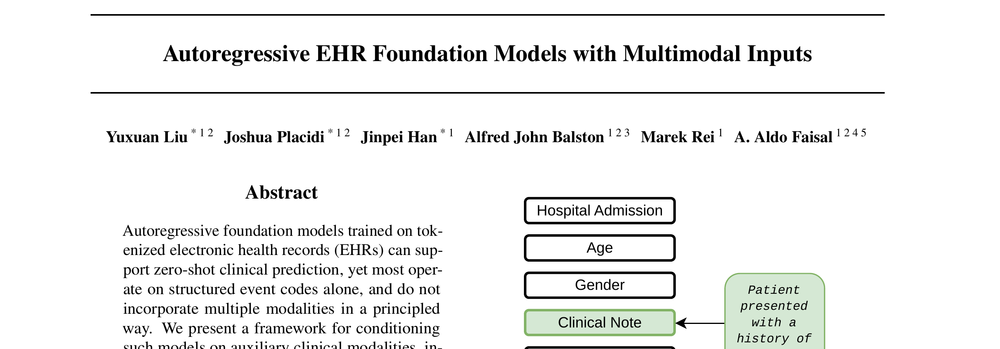
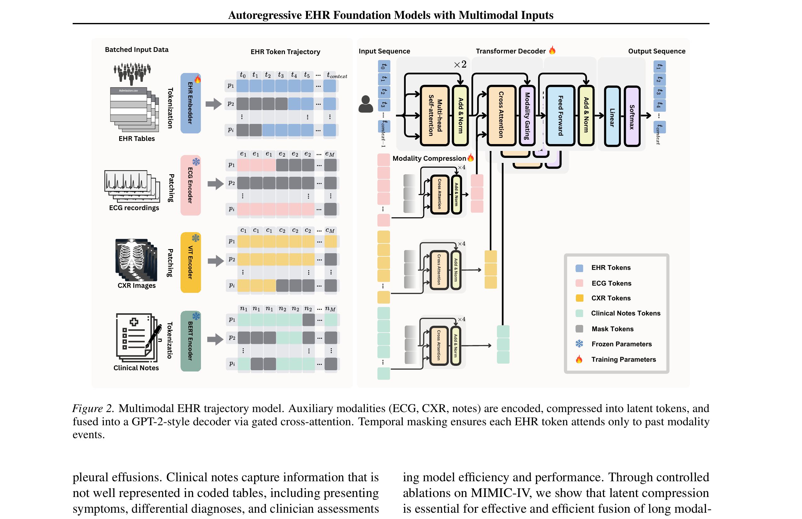
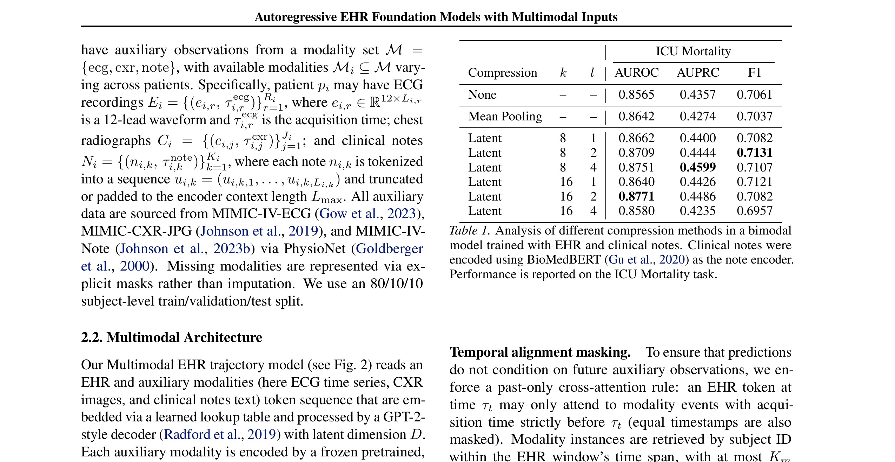
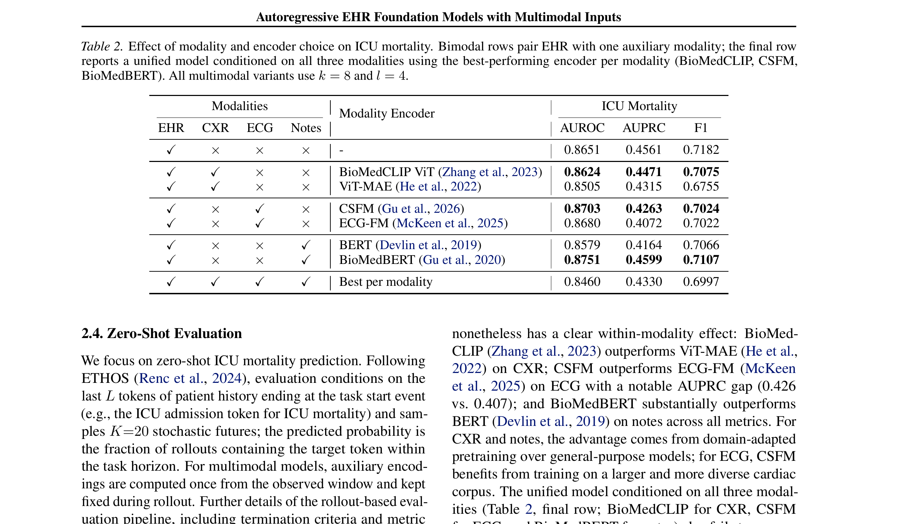
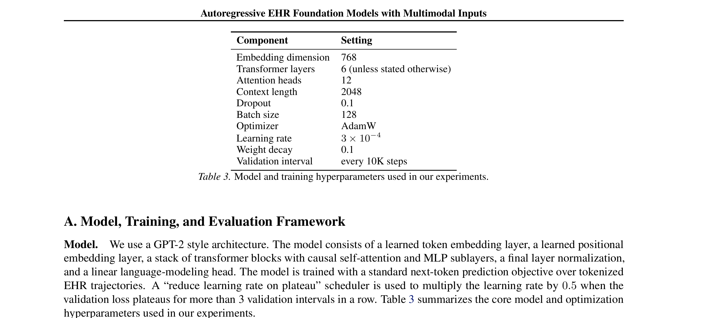

# Paper Analysis: Autoregressive EHR Foundation Models with Multimodal Inputs

## 1. Paper Information

- **Title:** Autoregressive EHR Foundation Models with Multimodal Inputs
- **Authors:** Yuxuan Liu, Joshua Placidi, Jinpei Han, Alfred John Balston, Marek Rei, A. Aldo Faisal
- **Affiliation:** Imperial College London, UKRI Centres in AI for Health, University of Bayreuth
- **Venue:** Workshop on Structured Data for Health at ICML 2026 (Seoul, South Korea)
- **Date:** July 2026

---

## 2. Core Problem & Motivation

### Problem
Most existing EHR foundation models operate solely on structured event codes (diagnoses, procedures, medications, vitals) as discrete token sequences, ignoring the rich multimodal clinical data that informs real-world clinical decision-making.

### Key Motivations
1. **Clinical reality is multimodal:** ECG waveforms, chest X-ray images, and clinical notes provide complementary evidence that structured codes alone cannot capture
2. **Temporal leakage risk:** Naive fusion of auxiliary modalities can cause future observations to influence past predictions
3. **Computational cost:** Long modality sequences (e.g., ECG time series) make naive cross-attention prohibitively expensive
4. **Unexplored design space:** No systematic study of how compression and encoder choice affect autoregressive EHR trajectory modeling

### Research Questions
1. How to compress long per-modality sequences before multi-modal cross-attention?
2. How does the choice of pretrained encoder for each modality impact downstream performance?
3. Does adding auxiliary modalities actually improve ICU mortality prediction?

---

## 3. Method Overview

### Architecture
The model extends a GPT-2-style decoder with three auxiliary modalities (ECG, CXR, clinical notes) via:
- **Modality-specific frozen encoders** (CSFM/ECG-FM for ECG, BioMedCLIP/ViT-MAE for CXR, BERT/BioMedBERT for notes)
- **Latent compression module** (Perceiver-inspired) that compresses modality sequences into k latent tokens
- **Gated cross-attention** (Flamingo-style) with learnable scalar gates
- **Temporal alignment masking** ensuring past-only cross-attention

### Key Equations

**Training Objective (Next-Token Cross-Entropy):**
```
L_CE(θ) = -Σ_u log p_θ(x_{i,u+1} | x_{i,≤u}, E_i, C_i, N_i)
```
where E_i, C_i, N_i are auxiliary ECG, CXR, and note inputs serving as conditioning only.

**Latent Compression:**
- Modality sequence of length N compressed to k latents (k << N)
- Reduces cross-attention cost from O(NT) to O(Nk + Tk)
- Latent queries are learned parameters refined through l layers of cross-attention

**Gated Cross-Attention:**
```
g_l = σ(β_l)
```
where g_l is a learnable scalar gate at layer l controlling modality update contribution.

**Temporal Alignment Masking:**
- EHR token at time τ_t may only attend to modality events with acquisition time strictly before τ_t
- Equal timestamps are also masked
- Combined with event-availability and padding masks

### Data
- **Source:** MIMIC-IV v3.1, MIMIC-IV-ECG, MIMIC-CXR-JPG, MIMIC-IV-Note
- **Format:** Medical Event Data Standard (MEDS)
- **Split:** 80/10/10 subject-level train/validation/test
- **Task:** Zero-shot ICU mortality prediction (rollout-based, K=20 stochastic futures)

---

## 4. Key Figures

### Figure 1: EHR Multimodal Events Representation


**Description:** Illustrates how electronic health records are represented as sequences of clinical events spanning multiple modalities — demographics, clinical notes, lab tests, ECG, and chest X-rays — with temporal gaps between events. This figure motivates the need for multimodal fusion beyond structured codes alone.

### Figure 2: Multimodal EHR Trajectory Model Architecture


**Description:** The core architecture diagram showing:
- **EHR stream:** Admission.csv → Tokenization → EHR Embedder → EHR Tokens → Transformer Decoder
- **ECG stream:** ECG recordings → Patching → ECG Encoder → Modality Compression → ECG Tokens
- **CXR stream:** CXR Images → Patching → ViT Encoder → Modality Compression → CXR Tokens
- **Notes stream:** Clinical Notes → Tokenization → BERT Encoder → Modality Compression → Clinical Notes Tokens
- **Fusion:** Gated cross-attention blocks interleaved with self-attention layers, with temporal masking ensuring past-only attention

### Table 1: Compression Ablation Study


**Description:** Comparison of compression methods (None, Mean Pooling, Latent with varying k and l) on ICU mortality. Latent compression with k=8, l=4 achieves best AUPRC (0.4599) and competitive AUROC (0.8751), outperforming both uncompressed cross-attention and mean pooling.

### Table 2: Modality and Encoder Ablation


**Description:** Systematic evaluation of modality and encoder choices. Key findings:
- EHR-only baseline: AUROC 0.8651, AUPRC 0.4561
- Only notes + BioMedBERT exceeds baseline (AUROC 0.8751, AUPRC 0.4599)
- CXR with either encoder performs below baseline
- Unified three-modelity model underperforms EHR-only baseline
- Domain-adapted encoders consistently outperform general-purpose alternatives

### Table 3: Model Hyperparameters


**Description:** GPT-2 style architecture with embedding dimension 768, 6 transformer layers, 12 attention heads, context length 2048, dropout 0.1, batch size 128, AdamW optimizer with learning rate 3×10⁻⁴.

---

## 5. Strengths & Weaknesses

### Strengths
1. **Rigorous ablation design:** Systematic study of compression methods, encoder choices, and modality combinations
2. **Temporal safety:** Past-only cross-attention masking prevents temporal leakage
3. **Computational efficiency:** Latent compression reduces attention cost from O(NT) to O(Nk + Tk)
4. **Honest negative results:** Clearly reports that adding modalities does not guarantee improvement, providing valuable insights for the community
5. **Strong baselines:** Comprehensive comparison with multiple encoder variants per modality

### Weaknesses
1. **Limited scope:** Only evaluates on ICU mortality prediction; generalizability to other tasks unclear
2. **Single dataset:** Only MIMIC-IV used; no external validation
3. **Frozen encoders:** All modality encoders are frozen, potentially limiting adaptation
4. **No multi-seed evaluation:** Results from single runs; stochastic rollout evaluation may be noisy
5. **Modest improvements:** Best multimodal configuration only marginally exceeds EHR-only baseline
6. **No imaging waveforms:** CXR is the only imaging modality; no CT, MRI, or ultrasound

---

## 6. Connection to Adaptive Temporal Semantics Learning

### Direct Relevance
This paper is **highly relevant** to our Adaptive Temporal Semantics Learning (ATSL) idea in several ways:

1. **Temporal alignment is critical:** The paper's past-only masking strategy directly relates to our need for temporally-aware fusion. Our ATSL could learn adaptive temporal alignment policies rather than using fixed causal masks.

2. **Latent compression as bottleneck:** The Perceiver-inspired compression is a form of learned temporal semantics — distilling long sequences into compact representations. Our ATSL could learn **adaptive** compression ratios based on clinical context.

3. **Modality competition problem:** The paper identifies that joint training leads to modality competition (EHR dominates, other modalities underfit). This is exactly the problem our ATSL aims to solve — learning when and how to attend to each modality based on temporal context.

4. **Encoder quality matters:** The finding that domain-adapted encoders outperform general-purpose ones suggests that **adaptive** encoder selection or fine-tuning could be beneficial in our framework.

5. **Negative result insight:** The observation that "adding modalities does not guarantee improvement" underscores the need for intelligent fusion — precisely what ATSL proposes to deliver through learned temporal semantics.

### Potential Integration
- Replace fixed temporal masks with **learned temporal attention policies**
- Use ATSL to dynamically adjust compression ratios k per modality per patient
- Apply adaptive modality gating based on clinical context rather than fixed gates
- Leverage ATSL to identify which modality contributes most at each temporal stage
