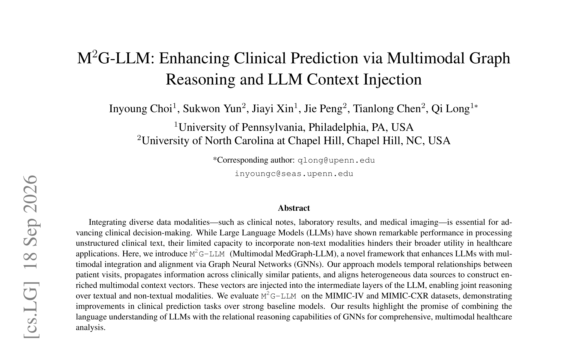
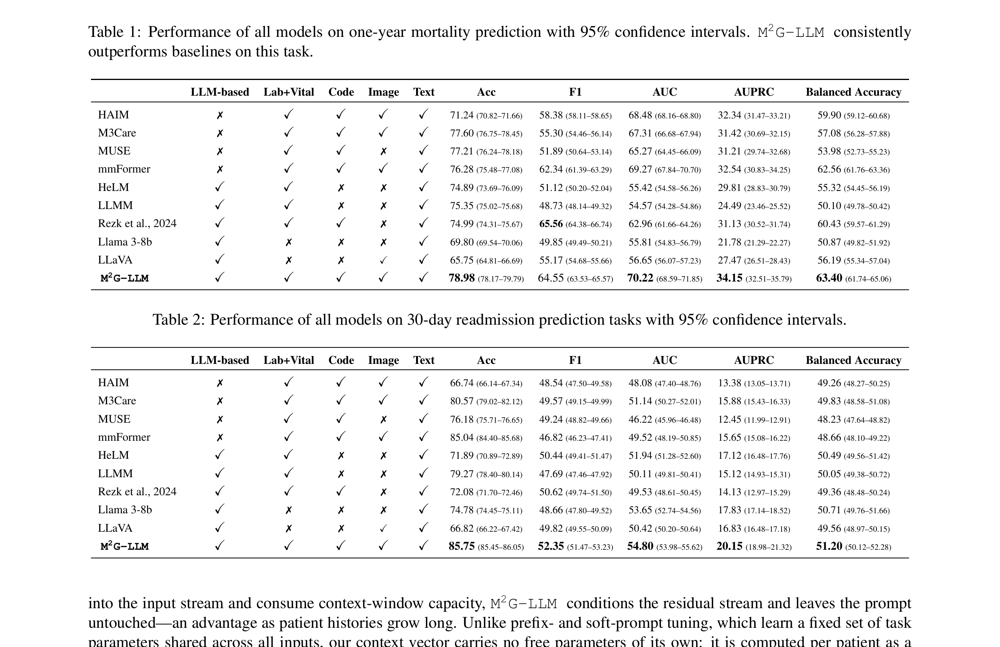
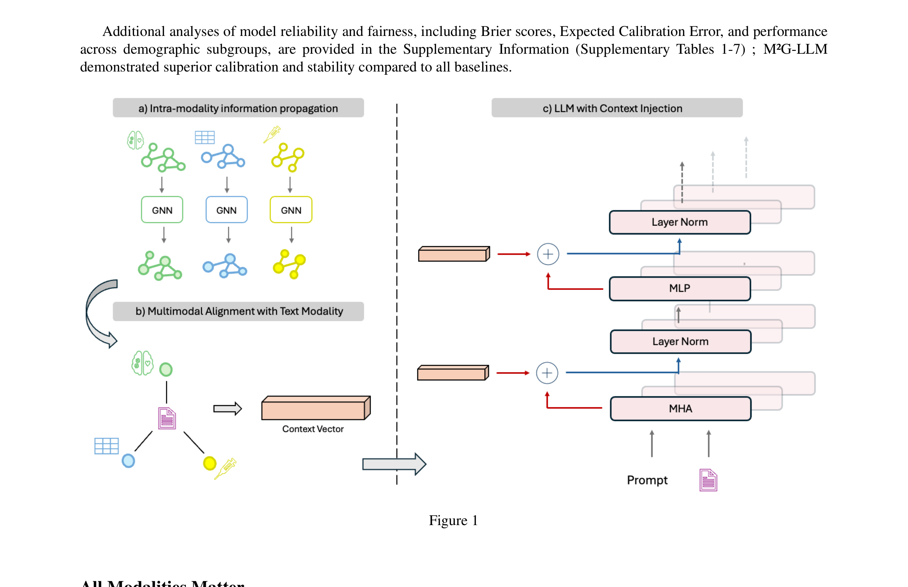
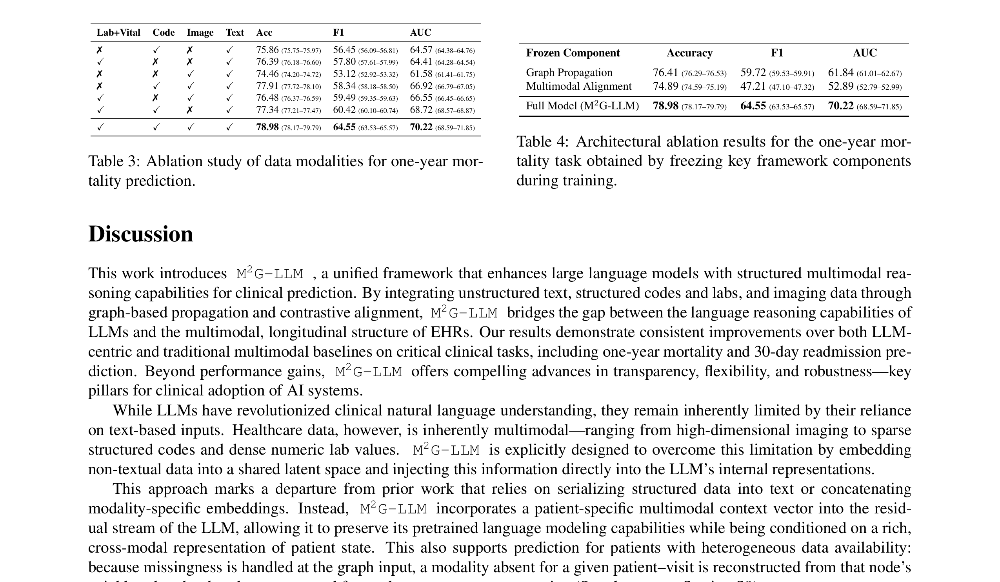
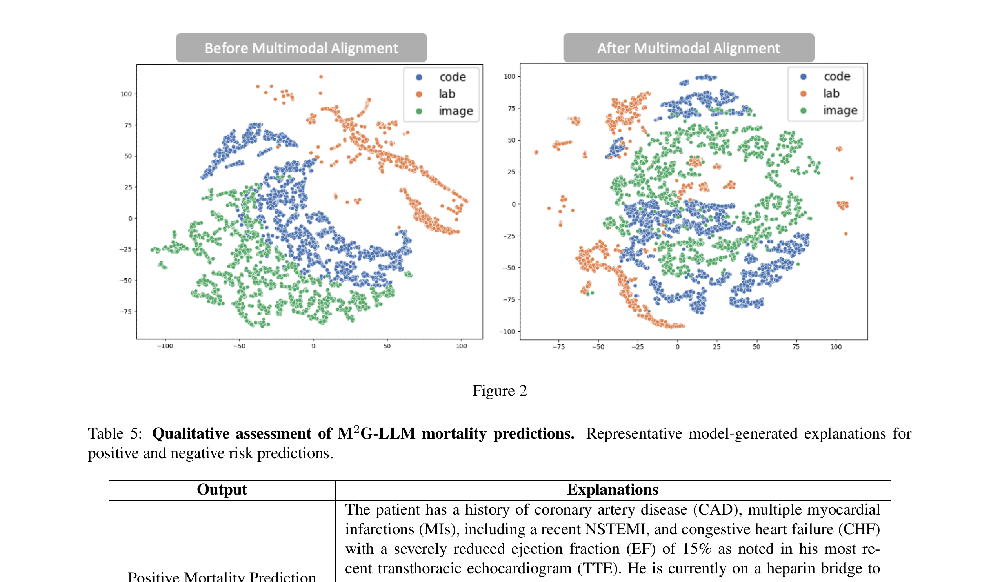
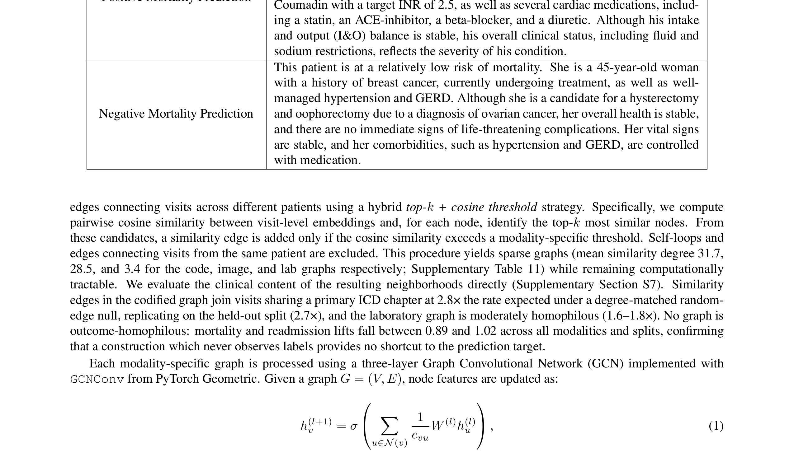

# Paper Analysis: M2G-LLM — Enhancing Clinical Prediction via Multimodal Graph Reasoning and LLM Context Injection

## 1. Paper Information

- **Title:** M2G-LLM: Enhancing Clinical Prediction via Multimodal Graph Reasoning and LLM Context Injection
- **Authors:** Inyoung Choi, Sukwon Yun, Jiayi Xin, Jie Peng, Tianlong Chen, Qi Long
- **Affiliations:** University of Pennsylvania, University of North Carolina at Chapel Hill
- **Venue:** arXiv preprint (arXiv:2609.21164), September 2026
- **Corresponding Author:** Qi Long (qlong@upenn.edu)

---

## 2. Core Problem & Motivation

### Problem
LLMs excel at processing clinical text but struggle to incorporate non-text modalities (lab values, diagnosis codes, imaging). Existing multimodal LLM approaches suffer from:
1. **Sample isolation:** Processing single patient at single time point, ignoring longitudinal progression
2. **Temporal blindness:** Failing to capture temporal dynamics of patient trajectories
3. **Context window exhaustion:** Concatenation-based fusion scales poorly with long patient histories
4. **Pseudo-token limitations:** Projecting non-text modalities into LLM input stream consumes context capacity

### Key Motivations
1. **Cross-patient reasoning:** Clinically similar patients share patterns that can inform predictions
2. **Longitudinal context:** Patient trajectories across multiple visits contain critical temporal information
3. **Efficient injection:** Conditioning the LLM's residual stream (rather than input) preserves context window
4. **Patient-specific representation:** Context vectors should be computed per patient, not learned as fixed parameters

### Research Questions
1. Can graph neural networks effectively model both intra-patient temporal and inter-patient similarity relationships?
2. Can contrastive alignment unify heterogeneous modalities into a shared space?
3. Can residual-stream conditioning inject multimodal context without modifying LLM architecture?

---

## 3. Method Overview

### Architecture: Three Core Components

**1. Graph-Based Information Propagation**
- Separate graph per modality (code, lab, image, text)
- Nodes = patient-visit instances
- Edges: temporal (consecutive visits) + similarity (top-k + cosine threshold)
- 3-layer GCN with message passing

**GCN Propagation Equation:**
```
h_v^(l+1) = σ(Σ_{u∈N(v)} (1/c_vu) W^(l) h_u^(l))
```
where h_v^(l) is the embedding of node v at layer l, N(v) is its neighborhood, c_vu is normalization, W^(l) is learnable weight.

**2. Multimodal Alignment via Contrastive Learning**
- Clinical text designated as central modality
- InfoNCE loss for alignment

**Alignment Loss:**
```
L_T,M = -log [exp(t_i^T m_i / τ) / Σ_{j=1}^{N} exp(t_i^T m_j / τ)]
```
where τ is temperature, N is batch size.

**Projection to Shared Space:**
```
z_m = LayerNorm(W_m e_m)
```

**Gated Fusion:**
```
c = Σ_m g_m · z_m,  g = softmax(θ)
```
where θ ∈ R⁴ is learned parameter vector for 4 modalities.

**3. Context Injection via Residual-Stream Conditioning**
- Context vector injected at two points per layer
- Uses forward hooks on final 4 transformer layers

**Injection Equations:**
```
s_l^t = r_l^{t-1} + λ_mha · v + β_mha · a_l^t
r_l^t = s_l^t + λ_mlp · v + β_mlp · m_l^t
```
where v is context vector, a_l^t and m_l^t are attention and MLP outputs, λ and β are scalar coefficients.

**Key Design Choices:**
- λ_mha = 0.10, λ_mlp = 1.0 (attention-side injection is weaker)
- β_mha = β_mlp = 1.0 (unscaled submodule outputs)
- LLM backbone: Llama 3-8B (frozen, 16.3 GB in bfloat16)
- Only 53.11M parameters (0.66%) trained
- Graph construction is inductive for training, transductive within inference cohort

### Data
- **MIMIC-IV:** Structured data (demographics, vitals, labs, ICD-9 codes, medications) + clinical notes
- **MIMIC-CXR:** Chest X-ray images linked via study_id/hadm_id/subject_id
- **Tasks:** One-year mortality, 30-day readmission
- **Cohort:** 13,478 unique subjects, 21,022 total clinical visits
- **Split:** 70% training, 30% testing at subject level

---

## 4. Key Figures

### Figure 1: M2G-LLM Framework Overview


**Description:** The overall architecture showing three main components:
- **Left:** Graph-based propagation — patient-visit graphs per modality with temporal and similarity edges, processed by 3-layer GCN
- **Center:** Multimodal alignment — contrastive learning aligning non-text modalities (code, lab, image) to clinical text space, followed by gated fusion
- **Right:** Context injection — multimodal context vector injected into LLM residual stream at multiple layers, enabling joint reasoning over text and structured data

### Table 1: One-Year Mortality Prediction Results


**Description:** M²G-LLM achieves 78.98% accuracy and 64.55 F1 on one-year mortality, outperforming all baselines including HAIM, M3Care, mmFormer, HeLM, and LLaVA-based approaches. Consistent improvements across 40 independent runs.

### Table 2: 30-Day Readmission Results


**Description:** M²G-LLM attains 85.75% accuracy and 52.35 F1 on 30-day readmission, again surpassing competitive baselines. GNN-based integration of multimodal signals leads to more balanced and clinically actionable predictions.

### Table 3: Modality Ablation Study


**Description:** Removing any modality consistently degrades performance. Structured data (labs + codes) is most impactful — dropping labs reduces F1 from 64.55 to 58.34. Text + image alone performs worst (F1 53.12). All four modalities together yield best performance (F1 64.55), validating synergistic multimodal reasoning.

### Figure 2: t-SNE Visualization of Modality Alignment


**Description:** t-SNE plots showing modality-specific embeddings before and after contrastive alignment. Before alignment: distinct, non-overlapping clusters per modality. After alignment: clusters become more interspersed, demonstrating that contrastive training effectively reorganizes the representation space for cohesive multimodal integration.

### Table 5: Qualitative Explanation Examples


**Description:** Representative model-generated explanations for positive and negative mortality predictions. High-risk predictions reference relevant clinical findings (CAD history, CHF, reduced EF, elevated BUN/creatinine). Low-risk predictions reference clinical stability indicators. Demonstrates interpretable natural language output capability.

---

## 5. Strengths & Weaknesses

### Strengths
1. **Novel integration pattern:** First framework to derive cross-patient, longitudinally-informed context vector from population graph for LLM conditioning
2. **Efficient injection:** Residual-stream conditioning leaves prompt untouched, preserving context window
3. **Patient-specific context:** Input-dependent representation (not learned constants)
4. **Comprehensive ablation:** Isolates contributions of graph propagation, alignment, and each modality
5. **Interpretability:** Generates natural language explanations alongside predictions
6. **Graceful degradation:** Handles missing modalities via graph-based reconstruction from similar neighbors
7. **Strong performance:** Outperforms both LLM-based and non-LLM multimodal baselines

### Weaknesses
1. **Scalability concern:** O(N²d) similarity matrix (~866 MB at current cohort size) grows quadratically
2. **Frozen LLM:** Llama 3-8B is not fine-tuned; may limit task-specific adaptation
3. **Single validation:** Retrospective prediction on MIMIC-IV/MIMIC-CXR only; no external or prospective validation
4. **Alignment quality:** t-SNE shows improved mixing but no quantitative alignment metric
5. **Temporal edges not separated:** Temporal and similarity edges removed together in ablation; individual contributions not isolated
6. **Limited modality scope:** Only text, codes, labs, and imaging; no ECG, waveforms, or genomics
7. **Explanation quality:** No systematic clinician evaluation of explanation faithfulness

---

## 6. Connection to Adaptive Temporal Semantics Learning

### Direct Relevance
This paper is **highly relevant** to our ATSL idea, particularly in the graph-based temporal reasoning and multimodal alignment aspects:

1. **Graph-based temporal modeling:** M2G-LLM's temporal edges (consecutive visits) encode longitudinal context. Our ATSL could learn **adaptive** temporal edge weights based on clinical relevance rather than simple adjacency.

2. **Population-level reasoning:** The inter-patient similarity edges enable cross-patient information sharing. ATSL could enhance this by learning **clinically meaningful** similarity metrics beyond cosine distance.

3. **Alignment as semantics learning:** The contrastive alignment module is a form of cross-modal semantics mapping. ATSL could extend this to **temporally-aware** alignment — aligning modalities not just per patient, but at each temporal stage.

4. **Gated fusion:** The learned gated sum (g = softmax(θ)) is a simple form of adaptive weighting. ATSL could provide **context-dependent** gating that varies per patient and per temporal stage.

5. **Modality missingness:** The graph-based reconstruction from neighbors is an elegant solution. ATSL could learn **which** neighboring patients to attend to based on temporal stage and clinical context.

### Key Differences
- M2G-LLM uses frozen LLM; ATSL could enable adaptive fine-tuning
- M2G-LLM processes text only at LLM input; ATSL could inject temporal semantics at multiple layers
- M2G-LLM's graph is static; ATSL could construct dynamic temporal graphs

### Potential Integration
- Replace fixed GCN propagation with **temporally-adaptive** graph attention
- Use ATSL to learn **stage-specific** modality importance weights
- Apply ATSL to dynamically construct patient similarity graphs based on temporal disease stage
- Integrate temporal semantics into the contrastive alignment objective
