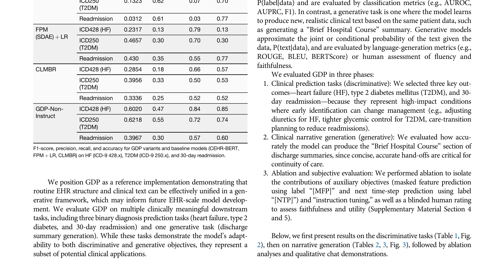

# Paper Analysis: A Multimodal Generative Model for Structured and Unstructured Electronic Health Records (GDP)

## 1. Paper Information

- **Title:** A multimodal generative model for structured and unstructured electronic health records
- **Authors:** Sonish Sivarajkumar, Hang Zhang, Yuelyu Ji, Maneesh Bilalpur, Xizhi Wu, Chenyu Li, Min Gu Kwak, Shyam Visweswaran, Yanshan Wang
- **Affiliation:** University of Pittsburgh (Intelligent Systems Program, Health Information Management, Biomedical Informatics, Clinical and Translational Science Institute, Hillman Cancer Center)
- **Venue:** npj Health Systems (2026) 3:46
- **DOI:** https://doi.org/10.1038/s44401-026-00095-y

---

## 2. Core Problem & Motivation

### Problem
EHRs contain both structured data (demographics, vitals, lab results, codes) and unstructured clinical notes. Existing approaches have critical limitations:
1. **Serialization approach:** Converting numeric EHR data to text loses temporal and quantitative detail, relies on hand-crafted schemas, and pushes against context limits
2. **Discriminative models:** FEMRs and CLaMs produce embeddings or text but lack generative capability for clinical narratives
3. **Separate encoders:** Prior multimodal fusion uses discriminative heads per task, lacking a unified generative framework

### Key Motivations
1. **Preserve native modality forms:** Structured EHR should be encoded numerically, not serialized to text
2. **Unified generative framework:** Single model supporting both classification AND narrative generation
3. **Joint training:** Combining self-supervised objectives on structured EHR with generative pretraining on discharge summaries
4. **Clinical utility:** Generating discharge summaries (Brief Hospital Course) can reduce documentation burden

### Research Questions
1. Can structured EHR time-series and clinical text be jointly modeled in a single LLM-style decoder?
2. Do auxiliary self-supervised objectives (masked feature prediction, next-time-step prediction) improve downstream performance?
3. Does instruction tuning help or hurt structured task performance?

---

## 3. Method Overview

### Architecture: GDP (Generative Deep Patient)

**Three Main Components:**

**1. Structured EHR Encoder (CNN-Transformer)**
- Input: Patient timeline with demographics, diagnoses (ICD-9/CPT-4), labs (LOINC), medications (RxNorm), vitals
- CNN layers capture local temporal patterns
- Transformer encoder captures long-range dependencies
- Outputs structured EHR representations

**2. Clinical Text Encoder (BERT-style)**
- Pretrained clinical language model
- Processes discharge summaries
- Outputs text representations

**3. LLaMA-based Generative Decoder with Cross-Modal Attention**
- Cross-attention from decoder to structured EHR representations
- Cross-attention from decoder to text representations
- Two variants: GDP-Instruct (instruction-tuned LLaMA) and GDP-Base (standard pretrained)

### Training Objectives

**Pretraining (three objectives):**
1. **Masked Feature Prediction (MFP):** Predict masked structured EHR features
2. **Next-Time-step Prediction (NTP):** Predict next event in patient timeline
3. **Generative Pretraining:** Generate discharge summary text

**Multi-task Fine-tuning:**
- Discriminative: HF, T2DM, 30-day readmission prediction
- Generative: Discharge summary (Brief Hospital Course) generation

### Data
- **Source:** MIMIC-IV (26,540 unique patients, 34,627 admissions, 2008-2019)
- **Format:** Medical Event Data Standard (MEDS)
- **Split:** 70% training, 15% validation, 15% holdout test (patient level)
- **Cohort:** HF (18,247 eligible admissions), T2DM (16,853), Readmission (34,627)
- **Positive rates:** HF ~11%, T2DM ~14%, Readmission ~15%

---

## 4. Key Figures

### Figure 1: GDP Architecture

**Description:** The multimodal architecture showing:
- **Left:** Structured EHR time-series → CNN-Transformer encoder → structured EHR representations
- **Center:** Clinical notes → BERT-style text encoder → text representations
- **Right:** LLaMA-based generative decoder with cross-modal attention to both encoders
- **Two modes:** Discriminative tasks (classification head) and Generative tasks (narrative generation)
- Cross-attention mechanism ties generation to patient data, preventing hallucination

### Figure 2: Discriminative Performance (AUROC & AUPRC)

**Description:** ROC and Precision-Recall curves for T2DM, HF, and 30-day readmission:
- **HF:** GDP-Non-Instruct AUROC = 0.923, substantially outperforming CEHR-BERT (0.779) and CLMBR (0.64)
- **T2DM:** GDP-Non-Instruct AUROC = 0.817 vs. CEHR-BERT 0.610
- **Readmission:** GDP-Non-Instruct AUROC = 0.627 vs. CEHR-BERT 0.589
- GDP-Non-Instruct achieves highest AUROC across all three tasks

### Figure 3: Human Evaluation Radar Chart

**Description:** Radar chart showing mean Likert ratings (1-5) for:
- **Faithfulness:** GDP-Instruct 4.4 (highest)
- **Completeness:** GDP-Instruct 4.2
- **Conciseness:** GDP-Instruct 4.0
- **Fluency:** GDP-Instruct 4.6 (highest)
- **Clinical Utility:** GDP-Instruct 4.3 (highest)
- GDP-Instruct outperforms GDP-Non-Instruct, Med42, and Meta Llama baselines across all dimensions

### Figure 4: Data Processing and Experimental Pipeline

**Description:** Three-stage pipeline:
- **A:** Data preparation — MIMIC-IV → MEDS format → structured events + clinical notes
- **B:** Generative pretraining — MFP + NTP + text generation on same patient cohort
- **C:** Multi-task fine-tuning — simultaneous optimization for prediction and generation

### Table 1: Discriminative Performance Metrics

**Description:** F1, precision, recall, and accuracy for GDP variants and baselines. GDP-Non-Instruct achieves F1 of 0.60 on HF (vs. 0.25 for CEHR-BERT), 0.62 on T2DM, and 0.40 on readmission. The auxiliary objectives (NTP especially) contribute significantly to downstream performance.

---

## 5. Strengths & Weaknesses

### Strengths
1. **Unified generative framework:** Single model for both classification AND narrative generation
2. **Native modality encoding:** Structured EHR encoded numerically, not serialized to text
3. **Auxiliary objectives:** NTP and MFP explicitly teach temporal structure and disease progression
4. **Strong performance:** Substantial improvement over baselines on HF (AUROC 0.923 vs 0.779) and T2DM
5. **Human evaluation:** Comprehensive blinded assessment with κ = 0.68 agreement
6. **Practical utility:** Discharge summary generation can reduce clinician documentation time
7. **Cross-attention grounding:** Generation tied to patient data reduces hallucination

### Weaknesses
1. **Single-center data:** Only MIMIC-IV; no external validation on other institutions
2. **Small LLM backbone:** 3.2B parameters, relatively small by modern standards
3. **Context length limit:** Structured sequences restricted to 50 time steps; single note per admission
4. **Limited task scope:** Only 3 prediction tasks + 1 generation task; no multi-class or survival analysis
5. **Full cross-attention cost:** Computationally expensive; no efficient fusion mechanism
6. **No imaging waveforms:** Only structured EHR + text; no CXR, ECG, or genomics
7. **Pre-trained ICD embeddings not used:** Randomly initialized code embeddings; ontological knowledge not leveraged
8. **Readmission performance modest:** AUROC 0.627 is only slightly above baseline 0.589

---

## 6. Connection to Adaptive Temporal Semantics Learning

### Direct Relevance
This paper is **moderately relevant** to our ATSL idea, with important insights:

1. **NTP objective aligns with temporal semantics:** The next-time-step prediction objective is essentially learning temporal semantics — predicting what comes next in a patient timeline. ATSL could enhance this by learning **adaptive** temporal semantics that vary by disease stage.

2. **Cross-attention as fusion mechanism:** GDP uses full cross-attention at each decoder layer. ATSL could provide **efficient** temporal semantics injection, reducing computational cost while improving performance.

3. **Instruction tuning trade-off:** The finding that GDP-Non-Instruct outperforms GDP-Instruct on structured tasks (but underperforms on generation) reveals a tension between discriminative and generative objectives. ATSL could **dynamically balance** these objectives based on the target task.

4. **Temporal patterns matter:** GDP's success is attributed to CNN-Transformer encoder and NTP objective capturing long-term temporal patterns. ATSL could explicitly model **multi-scale temporal semantics** (acute events, chronic progression, seasonal patterns).

5. **Data processing pipeline:** The MEDS format and structured event representation align well with our ATSL data representation needs.

### Key Differences
- GDP uses text generation as primary output; ATSL focuses on prediction
- GDP uses full cross-attention; ATSL could use efficient temporal semantics injection
- GDP uses fixed auxiliary objectives; ATSL could learn adaptive objectives

### Potential Integration
- Replace NTP with **adaptive temporal semantics prediction** that learns what to predict based on clinical context
- Use ATSL to learn **multi-scale temporal representations** (hour-level, day-level, visit-level)
- Apply ATSL to dynamically weight discriminative vs. generative objectives during fine-tuning
- Integrate temporal semantics into cross-attention to improve grounding
