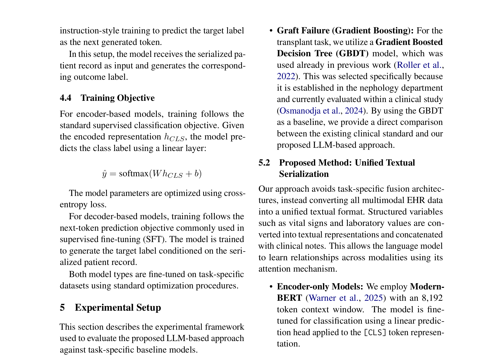
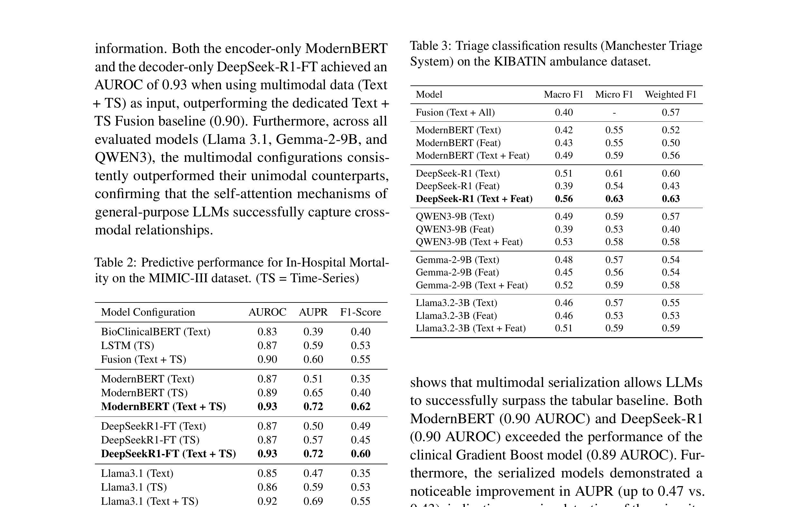
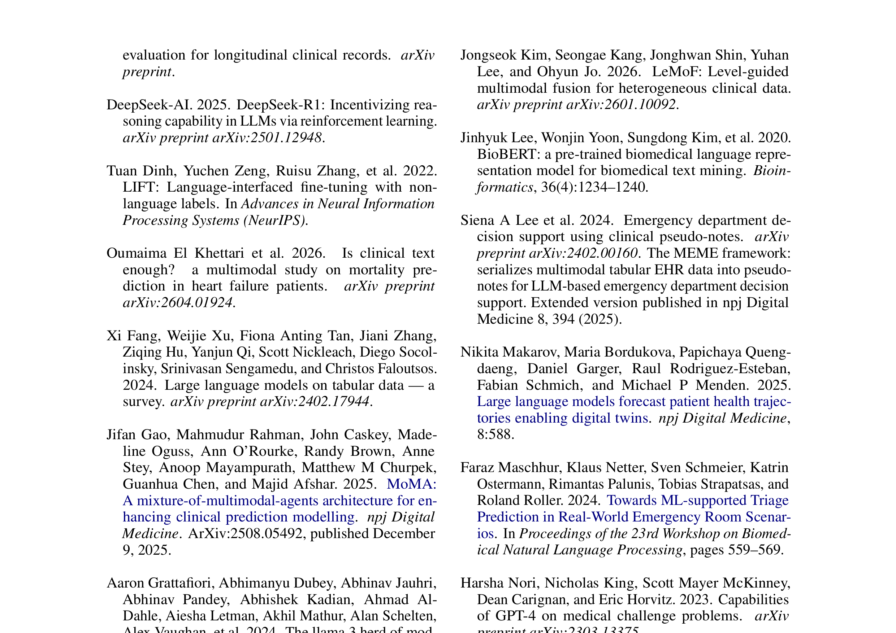

# Paper Analysis: Large Language Models as Unified Multimodal Learners for Clinical Prediction

## 1. Paper Information

- **Title:** Large Language Models as Unified Multimodal Learners for Clinical Prediction
- **Authors:** Ajay Madhavan Ravichandran, Bilgin Osmandoja, Klemens Budde, Klaus Netter, Tobias Strapatsas, Aljoscha Burchardt, Sebastian Möller, Roland Roller
- **Affiliations:** German Research Center for Artificial Intelligence (DFKI), Charité Universitätsmedizin Berlin, DNC Information Management GmbH, Klinik für Akut- und Notfallmedizin Asklepios Klinikum Harburg, Technical University Berlin
- **Venue:** arXiv preprint (arXiv:2607.15380), July 2026

---

## 2. Core Problem & Motivation

### Problem
Clinical prediction systems rely on task-specific fusion architectures — dedicated encoders per modality + learned combination mechanisms. This paradigm has critical limitations:
1. **Engineering overhead:** Each new task requires custom architecture, preprocessing, and tuning
2. **Poor reusability:** Systems are fragmented across clinical settings
3. **Deployment complexity:** Difficult to maintain and scale across hospitals

### Key Motivations
1. **Simplicity:** Convert all patient data into a single natural language sequence; fine-tune pretrained LM end-to-end
2. **No architectural modification:** LLM learns cross-modal relationships through self-attention without bespoke fusion
3. **Generality:** Same architecture and fine-tuning procedure across different modality combinations and prediction tasks
4. **Clinical deployment:** Outperforms a production-grade Gradient Boosting system used in clinical practice

### Research Questions
1. Can a single serialization-based paradigm replace task-specific fusion architectures?
2. How do encoder-only vs. decoder-only LMs compare on multimodal clinical prediction?
3. Can LLM-based approaches match or exceed clinically deployed ML systems?

---

## 3. Method Overview

### Core Approach: Unified Text Serialization

**Serialization Format:**
- Structured variables converted to key-value text pairs
- Concatenated with clinical narratives
- Single natural language sequence processed by pretrained LM

**Final Serialized Sequence:**
```
x = Serialize(x_struct) ⊕ x_text
```
where ⊕ denotes concatenation.

**Examples:**
- Time-invariant: Age, Sex, Heart Rate, Blood Pressure, etc. as key-value pairs
- Time-variant: Lab values and vitals as comma-separated time series per variable

### Model Architectures

**Encoder-based:**
- ModernBERT with 8,192 token context window
- [CLS] token representation + linear classification head
- Standard cross-entropy loss

**Decoder-based (SFT):**
- Llama 3.1, Gemma 2B, DeepSeek-R1-Qwen 8B, Qwen 3 8B
- Next-token prediction: generate target label as next token
- Supervised instruction-style training

### Training Objective
- Encoder: Standard supervised classification with cross-entropy loss
- Decoder: Next-token prediction for SFT

### Data & Tasks

| Dataset | Modalities | Task | Metrics |
|---------|-----------|------|---------|
| MIMIC-III | Notes + 13 time-series features | In-hospital mortality (48h) | AUROC, AUPRC |
| Graft Failure | Text + Labs + Vitals + Comorbidities | Graft failure (360 days) | AUROC, AUPRC |
| KIBATIN | Short notes + Vitals + Pain + GCS | MTS urgency (multi-class) | F1, Precision, Recall |

**Cohorts:**
- MIMIC-III: 21,139 ICU admissions (70/15/15 split)
- Graft Failure: 1,516 kidney transplant recipients (70/10/20 chronological split)
- KIBATIN: 18,000+ ambulance records (80/10/10 split)

---

## 4. Key Figures

### Figure 1: Serialized Input Example (Time-Invariant)


**Description:** Example of unified serialization for a triage patient with time-invariant data:
```
Patient Information:
Age: 67
Sex: Male
Heart Rate: 92 bpm
Blood Pressure: 130/80 mmHg
Creatinine: 1.4 mg/dL
Pain Score: 6
Clinical Note:
A 67-year-old male presented to the emergency department...
```
Shows how structured variables are converted to key-value text pairs and concatenated with clinical narrative.

### Figure 2: Serialized Input Example (Time-Variant)


**Description:** Example with time-series data serialized as comma-separated values:
```
Patient Information:
Heart Rate: 76.09, 78.75, 76.88, 69.75
Respiratory Rate: 19.19, 16.62, 16.62, 17.5
...
Clinical Note:
A 78-year-old male with a history of hypertension...
```
Demonstrates how temporal measurements are preserved in serialized form while remaining LLM-compatible.

### Table 2: In-Hospital Mortality Results (MIMIC-III)


**Description:** Unified serialization effectively integrates temporal and textual information:
- ModernBERT (Text + TS): AUROC 0.93, AUPRC 0.72 — matches DeepSeek-R1-FT
- Outperforms dedicated Text + TS Fusion baseline (AUROC 0.90)
- Multimodal configurations consistently outperform unimodal counterparts across all models
- Fusion baseline (0.90) is outperformed by unified serialization (0.93)

### Table 3: Triage Classification Results (KIBATIN)


**Description:** DeepSeek-R1 achieves Macro F1 of 0.56 with all features, significantly outperforming:
- Classic fusion baseline: 0.40 Macro F1
- ModernBERT: 0.49 Macro F1
- Text-only: 0.51 Macro F1 (generative models show strong text reliance)
- Feature-only: 0.39 Macro F1

### Figure 3: German Instruction Tuning Prompt


**Description:** Example instruction tuning prompt for graft failure prediction in German, showing the serialization format for transplant patients:
- Demographics, lifestyle factors, clinical measurements, lab values, transplant history
- All structured data in key-value format
- Task instruction at end: "Klassifizieren Sie, ob der Patient innerhalb der nächsten 360 Tage ein Transplantatversagen erleiden wird"

---

## 5. Strengths & Weaknesses

### Strengths
1. **Radical simplicity:** No task-specific fusion architecture; single serialization pipeline
2. **Clinical validation:** Outperforms production-grade GBDT on graft failure (0.90 vs 0.89 AUROC)
3. **Cross-domain generality:** Same approach works across ICU, transplant, and emergency settings
4. **Encoder-decoder comparison:** Systematic comparison of ModernBERT vs. generative models
5. **Multimodal consistency:** Multimodal always outperforms unimodal across all models
6. **Reduced engineering:** Single pipeline replaces fragmented fusion architectures
7. **Strong baselines:** Compares against BioClinicalBERT, LSTM, and custom fusion baselines

### Weaknesses
1. **Context window expansion:** Numeric lab matrix consumes many tokens when serialized; may challenge limits for long histories
2. **Information loss:** Converting numbers to text may lose precision and temporal relationships
3. **No temporal modeling:** Serialized values lose explicit temporal ordering and irregular sampling information
4. **Limited interpretability:** No mechanism to understand which temporal features drive predictions
5. **No waveform/image handling:** Only text and tabular data; no ECG, imaging, or genomics
6. **Serialization sensitivity:** Performance may vary with formatting and phrasing choices
7. **Missing data handling:** NA values in serialization may not optimally represent missingness patterns
8. **Single-language:** German prompt example but no multilingual evaluation

---

## 6. Connection to Adaptive Temporal Semantics Learning

### Direct Relevance
This paper is **relevant** to our ATSL idea, but from a different angle — it represents the "naive baseline" that ATSL aims to improve upon:

1. **Serialization as anti-pattern:** The paper's approach of flattening structured data to text is exactly what ATSL seeks to move beyond. Our approach preserves native modality structure while learning temporal semantics.

2. **Temporal information loss:** The serialization format (comma-separated values) loses explicit temporal ordering and irregular sampling. ATSL explicitly models these temporal relationships.

3. **No adaptive fusion:** The paper relies on LLM self-attention to discover cross-modal relationships. ATSL provides **explicit, learned** temporal semantics for fusion.

4. **Context window problem:** The paper acknowledges token expansion as a limitation. ATSL's latent compression (à la Perceiver) could address this efficiently.

5. **Modality-specific processing:** ATSL would use modality-specific encoders (CNN for time-series, ViT for images) rather than converting everything to text.

### Key Differences
- **Representation:** Serialization (text-only) vs. ATSL (native multi-modal)
- **Temporal modeling:** Implicit (LLM attention) vs. ATSL (explicit temporal semantics)
- **Engineering:** Simple but lossy vs. ATSL (more complex but preserves information)
- **Scalability:** Challenged by context limits vs. ATSL (bounded compute via latent compression)

### Lessons for ATSL
1. **LLMs can integrate multimodal information** when given unified input — validates the concept of shared representation spaces
2. **Text is a strong modality** — generative models show strong text reliance in triage
3. **Simplicity has value** — ATSL should aim for practical deployment, not just performance gains
4. **Clinical validation matters** — comparison with deployed GBDT sets a high bar for clinical utility
5. **Multimodal > unimodal** — consistent finding across all models validates the need for fusion, but ATSL can do it more effectively than serialization

### Potential Integration
- Use ATSL to create **semantically rich** serialized representations that preserve temporal structure
- Apply ATSL's temporal semantics to enhance the serialized format with explicit temporal markers
- Combine ATSL's modality-specific encoders with LLM fine-tuning for best of both worlds
- Use ATSL to learn **adaptive serialization** that optimizes information preservation for each task
