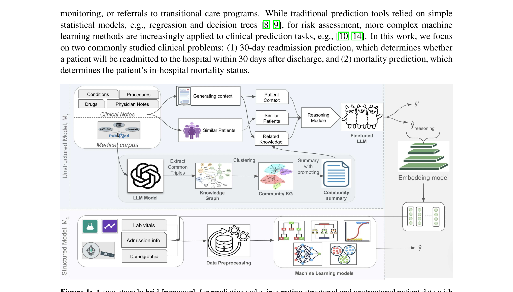
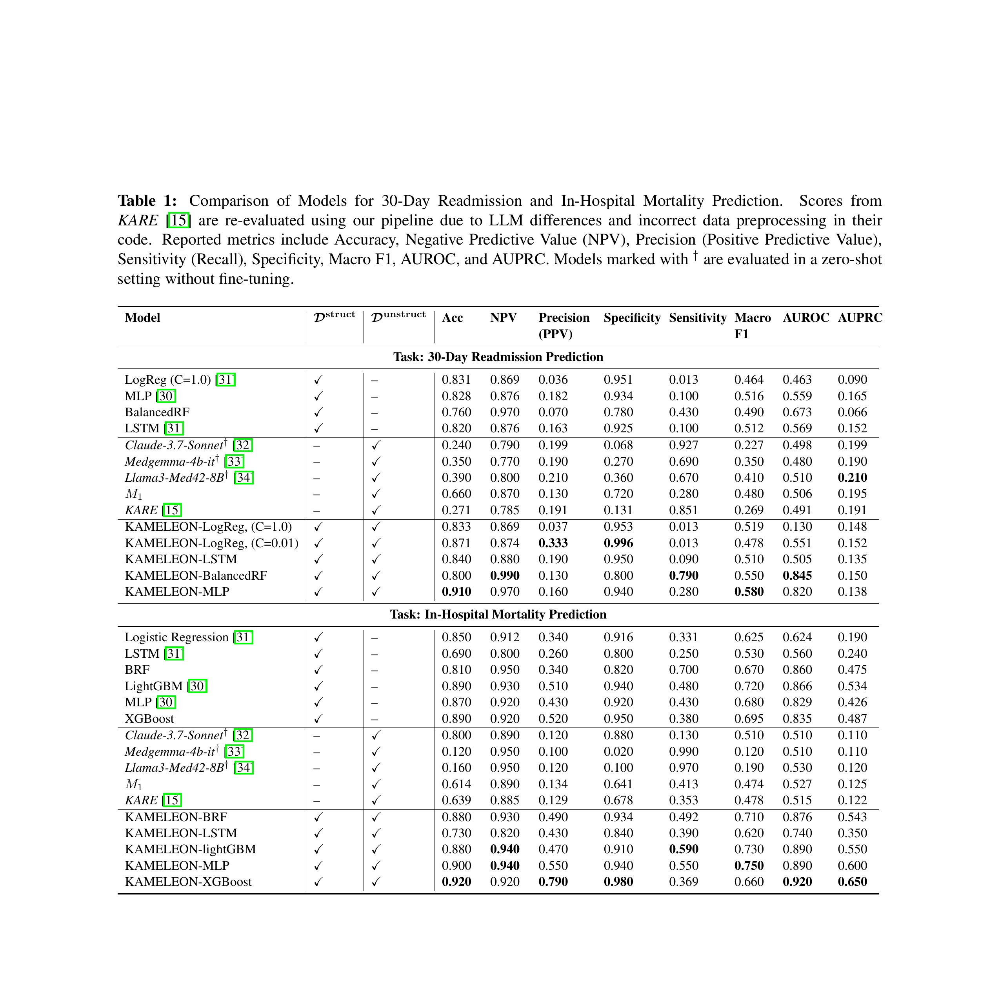
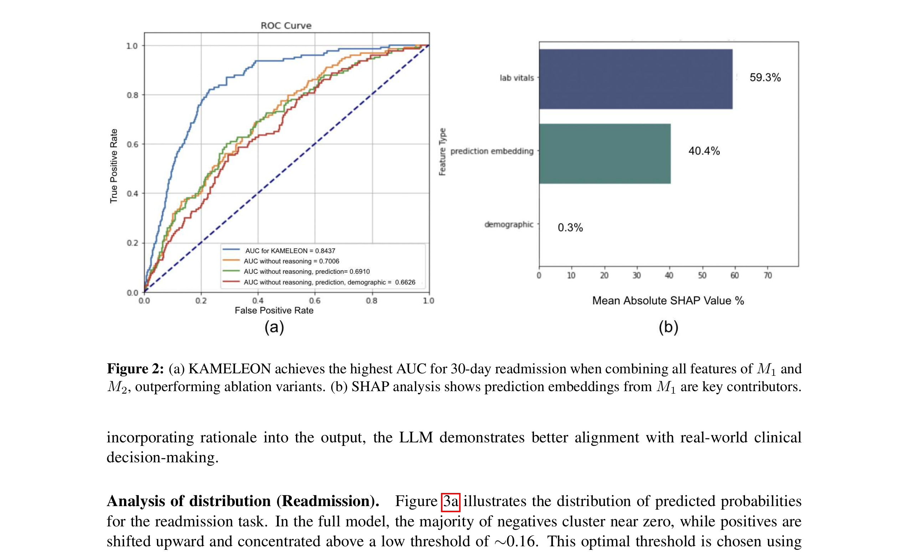
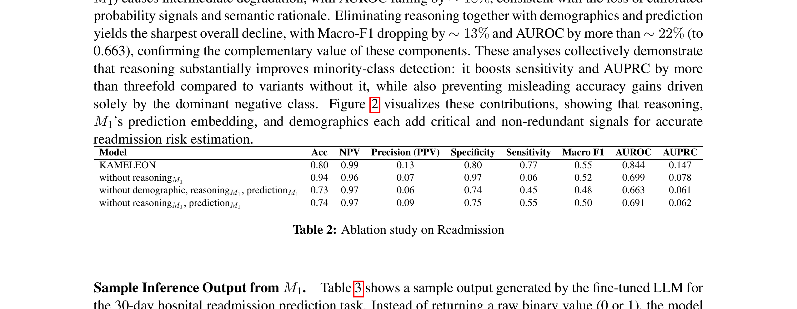
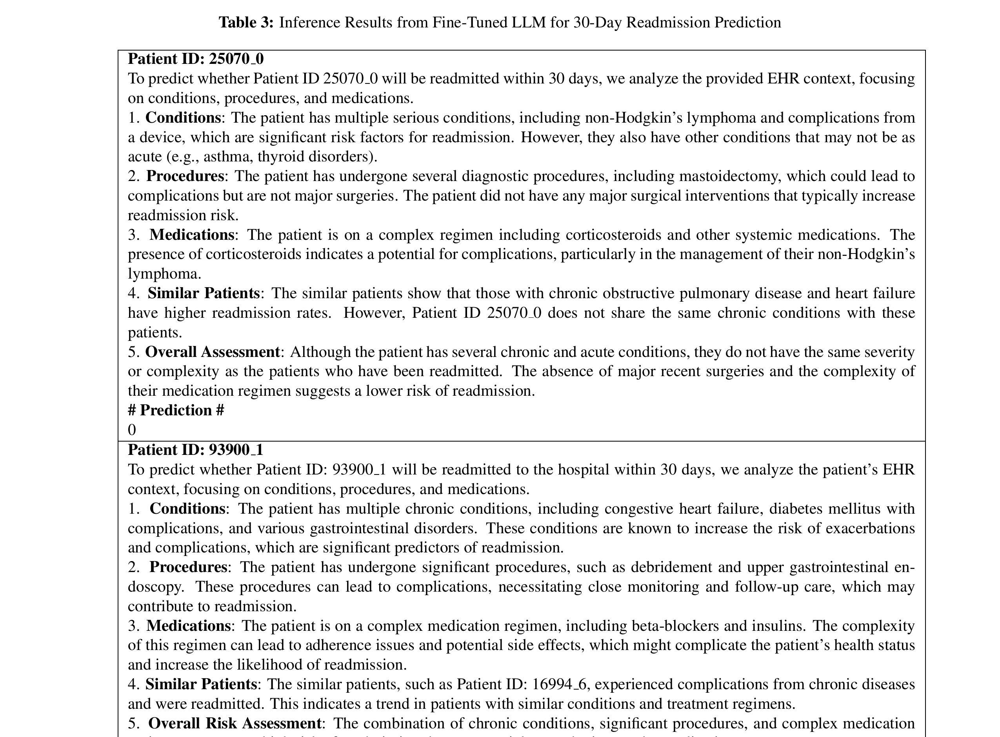

# KAMELEON: Knowledge-Augmented Multimodal EHR LEarning for Outcome predictioN

## 1. 论文基本信息

- **标题**: Improving Hospital Risk Prediction with Knowledge-Augmented Multimodal EHR Modeling
- **作者**: Rituparna Datta, Jiaming Cui, Zihan Guan, Vishal G. Reddy, Joshua C. Eby, Gregory Madden, Rupesh Silwal, Anil Vullikanti
- **机构**: University of Virginia (CS, Medicine, Biocomplexity Institute), Virginia Tech
- **发表**: arXiv:2508.01970v2, 2025年8月
- **关键词**: 多模态EHR、知识增强、LLM、临床风险预测、知识图谱

---

## 2. 核心问题与动机

### 2.1 临床背景
临床风险预测（如30天再入院预测、院内死亡预测）对早期干预、资源分配和患者护理至关重要。EHR数据包含**结构化数据**（诊断、手术、药物、生命体征等）和**非结构化数据**（临床笔记），两者都蕴含丰富的患者信息。

### 2.2 现有方法的局限
1. **多模态挑战**: 现有方法通常只使用结构化数据或仅用简单方式（如BOW、TF-IDF）处理非结构化文本，未能有效融合两种模态
2. **长文本处理困难**: 临床笔记通常很长，包含专业术语和非正式表达，信息提取困难
3. **严重类别不平衡**: 30天再入院预测的正样本率仅约4%，数据极度不平衡
4. **LLM的局限性**: 虽然LLM能处理临床笔记，但存在幻觉、事实不准确、领域知识不足等问题
5. **GraphRAG的不足**: 现有基于图的检索增强方法缺乏显式推理能力

### 2.3 核心洞察
将**知识图谱增强的LLM推理**与**结构化机器学习**相结合，可以同时利用非结构化文本的语义信息和结构化数据的统计特征，从而提升临床预测性能。

---

## 3. 方法概述

KAMELEON采用**两阶段混合架构**（Two-Stage Hybrid Framework）：

### 3.1 阶段一：非结构化模型 M1（知识增强上下文生成）

M1处理临床笔记并检索相关生物医学知识，生成知识增强的上下文：

1. **临床笔记摘要**: 使用LLM对超长临床笔记进行摘要，适应上下文窗口限制
2. **知识图谱构建**: 整合UMLS、PubMed摘要和LLM生成的实体-关系三元组，构建生物医学知识图谱（KG）
3. **社区聚类与摘要**: 将KG划分为语义连贯的社区，为每个患者社区生成文本摘要
4. **相似患者检索**: 识别语义相似的患者就诊记录，添加标注上下文
5. **LLM微调**: 使用上述增强上下文微调LLM，生成预测和推理

### 3.2 阶段二：结构化模型 M2（多模态融合预测）

M2整合所有信息进行最终预测：

1. **结构化特征提取**: 提取静态人口统计学/入院数据、时变生命体征（归一化摘要）、诊断/手术/药物编码
2. **LLM输出嵌入**: 将M1的预测和推理通过嵌入模型转化为向量
3. **多模态融合**: 将结构化特征与LLM嵌入拼接
4. **ML预测器**: 使用多种标准ML方法（LogReg、MLP、LSTM、BalancedRF、XGBoost等）进行最终预测

### 3.3 关键公式

**知识图谱社区发现**:
- 使用社区检测算法（如Louvain）将KG划分为语义连贯的社区
- 为每个社区生成LLM摘要作为上下文增强

**M1输出**:
$$\hat{y}_{M1}, \text{reasoning} = \text{LLM}_{\text{finetuned}}(\text{context}_{\text{augmented}})$$

**M2融合预测**:
$$\hat{y} = \text{ML}([\mathbf{x}_{\text{struct}}; \text{Embed}(\hat{y}_{M1}, \text{reasoning})])$$

其中 $\mathbf{x}_{\text{struct}}$ 是结构化特征向量，$\text{Embed}(\cdot)$ 是嵌入模型。

---

## 4. 关键图表解析

### 4.1 整体框架图

**图1解析**: 展示了KAMELEON的完整两阶段架构：
- **上半部分（M1）**: 临床笔记 → 生成上下文 → 结合知识图谱（PubMed/UMLS）→ 社区聚类与摘要 → 相似患者检索 → 微调LLM → 输出预测和推理
- **下半部分（M2）**: 结构化数据（生命体征、入院信息、人口统计学）→ 数据预处理 → 与LLM嵌入融合 → ML模型 → 最终预测
- **关键设计**: M1的输出（预测+推理）通过嵌入模型转化为向量，作为M2的输入之一

### 4.2 主要性能对比

**表1解析**: 30天再入院和院内死亡预测的全面对比：
- **30天再入院**: KAMELEON-BalancedRF达到最高AUROC 0.845，KAMELEON-MLP达到最高准确率0.910和Macro F1 0.580
- **院内死亡**: KAMELEON-XGBoost达到最高AUROC 0.920，KAMELEON-MLP达到最高准确率0.920
- **关键发现**: KAMELEON在所有指标上显著优于所有基线模型（包括LLM零样本方法和传统ML方法）
- **LLM基线表现差**: Claude-3.7-Sonnet、Medgemma-4b-it、Llama3-Med42-8B的AUROC普遍低于0.55

### 4.3 ROC曲线与SHAP分析

**图2解析**: 
- **左图（ROC曲线）**: 完整KAMELEON的AUC=0.8437，显著优于去除推理（0.7006）和去除推理+预测（0.6910）的变体
- **右图（SHAP分析）**: 预测嵌入（59.3%）和生命体征（40.4%）是30天再入院预测的关键特征，人口统计学仅贡献0.3%
- **关键洞察**: LLM推理嵌入是最重要的单一特征，但结构化特征（生命体征）也贡献显著

### 4.4 消融实验

**表2解析**: 30天再入院任务的消融实验：
- **完整KAMELEON**: Acc=0.80, AUROC=0.844, AUPRC=0.147
- **去除推理**: AUROC降至0.699（下降17%），AUPRC降至0.078（下降47%）
- **去除人口统计学+推理**: AUROC降至0.663（下降21%）
- **去除推理+预测**: AUROC降至0.691（下降18%）
- **关键结论**: 推理组件对少数类检测至关重要，移除后敏感度下降超过80%

### 4.5 LLM推理输出示例

**表3解析**: 微调LLM的推理输出示例：
- **患者25070_0**: 有非霍奇金淋巴瘤和装置并发症，但无重大手术，预测不再入院（低风险）
- **患者93900_1**: 有充血性心衰、糖尿病伴并发症、胃肠道疾病，接受重大手术，预测将再入院（高风险）
- **关键特性**: LLM生成结构化的临床推理（疾病分析、手术分析、药物分析、相似患者比较、整体评估），而非简单的二分类输出

---

## 5. 优势与不足

### 5.1 优势
1. **系统性框架**: 首个将知识图谱增强LLM与结构化ML系统结合的临床预测框架
2. **可解释性强**: LLM生成结构化推理，SHAP分析提供特征重要性
3. **性能卓越**: 在MIMIC-III上显著优于所有现有方法，包括强LLM基线
4. **知识增强**: 通过PubMed知识图谱和相似患者检索，有效减少LLM幻觉
5. **灵活性**: M2可使用多种ML方法，适应不同临床任务
6. **类别不平衡处理**: 通过BalancedRF和AUPRC等指标有效处理不平衡数据

### 5.2 不足
1. **计算成本高**: 需要构建知识图谱、微调LLM、训练多个ML模型，流程复杂
2. **数据依赖**: 需要PubMed语料和UMLS知识库，资源受限环境难以复现
3. **外部验证有限**: 主要在MIMIC-III上验证，仅提及"其他私人EHR"但未详细报告
4. **MIMIC-III的局限性**: 无法区分计划性和非计划性再入院，可能高估"可避免"再入院
5. **LLM推理质量**: 虽然提供了推理示例，但未系统评估推理的临床准确性
6. **阈值选择**: 使用Youden's J统计量选择阈值，但在极端不平衡场景下可能不是最优

---

## 6. 与Adaptive Temporal Semantics Learning的关联

### 6.1 直接启发
1. **知识增强范式**: KAMELEON的知识图谱+LLM范式可以直接应用于我们的时序语义学习框架，通过知识图谱增强时序EHR数据的语义表示
2. **两阶段架构**: 先学习语义表示，再融合结构化特征进行预测，这种解耦设计值得借鉴
3. **推理嵌入**: 将LLM的推理过程编码为嵌入向量作为下游任务输入，是一种有效的知识蒸馏方式

### 6.2 可改进方向
1. **时序建模不足**: KAMELEON的M2主要使用静态特征，未充分利用EHR的时序特性。我们的Adaptive Temporal Semantics Learning可以弥补这一缺陷
2. **动态知识检索**: KAMELEON的知识图谱是静态的，我们可以实现基于患者时序状态的动态知识检索
3. **自适应融合**: KAMELEON使用简单的特征拼接，我们可以设计自适应的时序感知融合机制
4. **生存分析扩展**: KAMELEON仅处理二分类任务，我们的框架可以扩展到时间-to-event预测

### 6.3 互补性
- KAMELEON提供了**知识增强+多模态融合**的有效范式
- 我们的方法提供**时序语义建模+自适应融合**的能力
- 两者结合可以构建更强大的临床预测系统：知识增强的时序多模态融合模型
