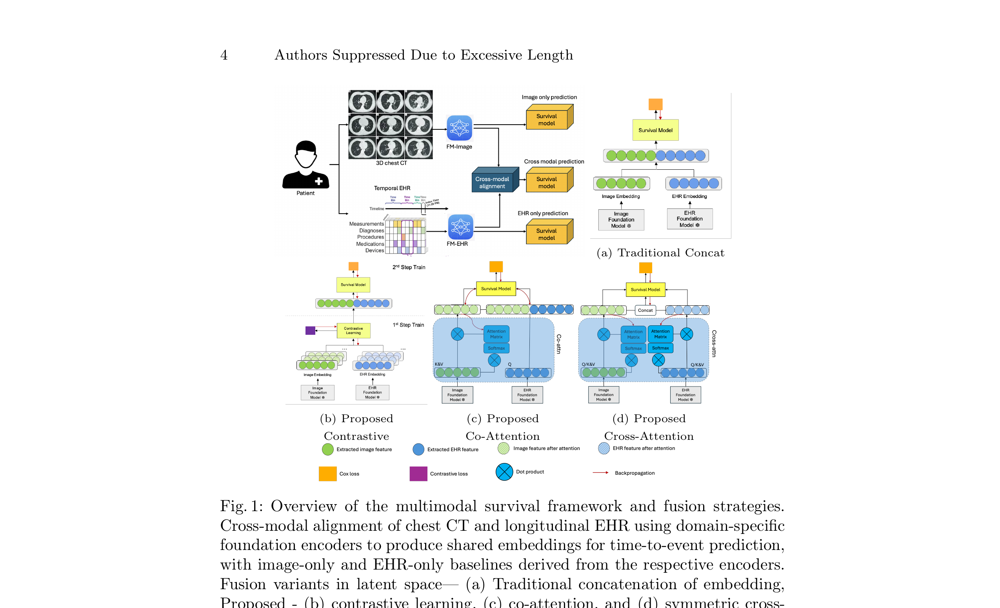
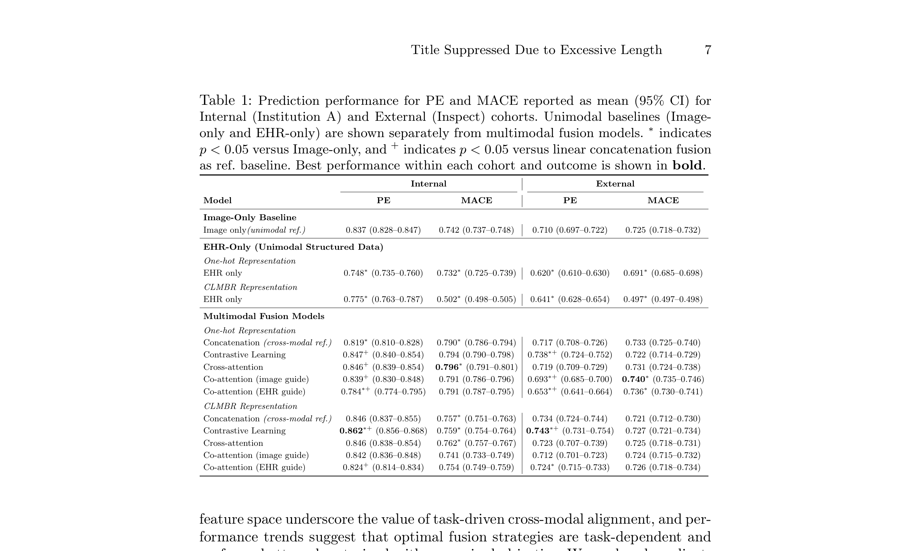
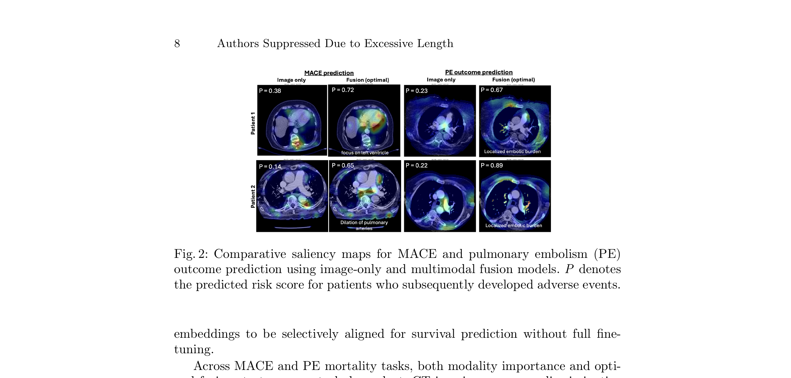

# Fusion is not one-size-fits-all: Cross-Modal Representation Alignment for Time-to-Event Modeling

## 1. 论文基本信息

- **标题**: Fusion is not one-size-fits-all: Cross-Modal Representation Alignment for Time-to-Event Modeling
- **作者**: Zhemin Zhang, Weijie Chen, David Le, Amara Tariq, Alex Wallace, Matthew Stib, Juan Maria Farina, Chadi Ayoub, Reza Arsanjani, Imon Banerjee
- **机构**: Arizona State University, Mayo Clinic
- **发表**: arXiv:2606.15038v1, 2026年6月
- **关键词**: 时间-to-event预测、多模态融合、基础模型、生存分析、跨模态对齐

---

## 2. 核心问题与动机

### 2.1 临床背景
准确预测临床不良结局的概率和时间（Time-to-Event, TTE）对高风险疾病（如肺栓塞PE、心血管疾病CVD）的监测、干预和资源分配至关重要。传统风险评分（如sPESI、PCE）依赖静态表格变量，忽略了高维影像数据和纵向EHR上下文。

### 2.2 现有方法的局限
1. **模态不平衡**: 不同模态（影像 vs EHR）对预测的贡献不均衡，现有方法未系统分析
2. **融合策略选择盲目**: 现有多模态方法通常启发式选择融合策略，缺乏对融合机制与时间目标交互的探索
3. **基础模型未优化**: 3D影像和临床序列的基础模型通常预训练于通用目标，未针对TTE预测优化
4. **分布偏移**: 跨机构、跨人群的泛化能力不足
5. **缺乏系统分析**: 首次在模态不平衡条件下系统分析融合行为

### 2.3 核心洞察
**融合策略不是万能的**——最优融合策略取决于具体任务、模态贡献比例和目标队列。需要系统对比不同融合策略（对比学习、交叉注意力、协同注意力、拼接）在TTE预测中的表现。

---

## 3. 方法概述

### 3.1 整体框架

提出一个基础模型驱动的多模态TTE预测框架，包含：
1. **独立模态编码**: 使用领域特定基础模型分别编码CT影像和EHR数据
2. **跨模态对齐**: 在共享潜在空间中对齐两种模态的表示
3. **生存目标优化**: 使用NLL生存目标端到端优化融合表示

### 3.2 基础模型

**影像基础模型 - MedImageInsight (MII)**:
- 预训练医学影像基础模型，将2D切片编码为1×1024嵌入
- 3D CT处理: 选择含心脏结构的轴位切片 → 软组织窗（PE: [-1350,150] HU; MACE: [-125,225] HU）→ 独立编码 → z维度平均 → 1×1024体积级表示

**EHR基础模型 - CLMBR-T-base**:
- 自回归Transformer，通过自监督下一代码预测在纵向EHR数据上预训练
- 编码时间有序临床代码，产生768维患者级嵌入
- 使用Stanford公开checkpoint，提取固定嵌入不微调
- 替代方案: 手动策划的1-hot编码（人口统计学、实验室结果、药物、诊断、手术代码）

### 3.3 四种融合策略

#### (a) 传统拼接 (Baseline)
$$h_{\text{fused}} = \text{concat}(h_{\text{img}}, h_{\text{ehr}})$$

#### (b) 对比学习 (Contrastive)
两步训练：先对齐，再预测
- **Step 1**: 对称对比目标对齐影像和EHR嵌入
$$S_{ij} = \frac{\text{sim}(h_i^{\text{img}}, h_j^{\text{ehr}})}{\tau}$$
$$\mathcal{L} = -\frac{1}{N}\sum_{i=1}^{N}\left[\log\frac{e^{S_{ii}}}{\sum_{j=1}^{N}e^{S_{ij}}} + \log\frac{e^{S_{ii}}}{\sum_{j=1}^{N}e^{S_{ji}}}\right]$$
- **Step 2**: 用对齐后的嵌入训练TTE生存模型

#### (c) 协同注意力 (Co-Attention)
一个模态作为query，另一个作为key/value：
$$\text{CoAttn}_{\text{ehr}\to\text{img}}(h_{\text{ehr}}, h_{\text{img}}) = \text{softmax}\left(\frac{Q_{\text{ehr}}K_{\text{img}}^\top}{\sqrt{d_k}}\right)V_{\text{img}}$$
$$h_{\text{fused}} = \text{concat}(h_{\text{img}}, A_{\text{coattn}})$$

#### (d) 交叉注意力 (Cross-Attention)
双向注意力，两个模态互相attend：
$$A_{\text{ehr}\leftarrow\text{img}} = \text{softmax}\left(\frac{Q_{\text{ehr}}K_{\text{img}}^\top}{\sqrt{d_k}}\right)V_{\text{img}}$$
$$A_{\text{img}\leftarrow\text{ehr}} = \text{softmax}\left(\frac{Q_{\text{img}}K_{\text{ehr}}^\top}{\sqrt{d_k}}\right)V_{\text{ehr}}$$
$$h_{\text{fused}} = \text{concat}(h_{\text{ehr}}, A_{\text{ehr}\leftarrow\text{img}}, h_{\text{img}}, A_{\text{img}\leftarrow\text{ehr}})$$

### 3.4 TTE生存目标

$$\mathcal{L}_{\text{TTE}} = -\sum_{i=1}^{N}\log p(T_i, \delta_i | h_{\text{fused},i}) + \lambda\|\theta\|_2^2$$

其中 $T_i$ 是观察/删失时间，$\delta_i$ 是事件指示器，$\lambda$ 是正则化超参数。梯度仅通过融合模块和任务特定层传播，基础编码器保持冻结。

---

## 4. 关键图表解析

### 4.1 多模态融合框架图

**图1解析**: 展示了完整的TTE多模态融合框架和四种融合策略：
- **顶部**: 患者 → 3D胸部CT → FM-Image编码 → 生存模型（影像only基线）
- **中部**: 患者 → 时序EHR → FM-EHR编码 → 生存模型（EHR-only基线）
- **融合策略**:
  - (a) 传统拼接: 直接concat影像和EHR嵌入
  - (b) 对比学习: 2步训练，先对比对齐再预测
  - (c) 协同注意力: 一个模态引导另一个
  - (d) 交叉注意力: 双向注意力机制
- **关键设计**: 基础编码器冻结，仅融合模块和生存层可训练

### 4.2 预测性能对比

**表1解析**: PE和MACE的内外验证性能（AUC, 95% CI）：

**PE预测（肺栓塞死亡）**:
- **内部验证**: CLMBR对比学习最优（AUC 0.862, p<0.05 vs image-only）
- **外部验证**: CLMBR对比学习最优（AUC 0.743, p<0.05 vs image-only）
- **EHR-only显著差于image-only**（p<0.05），说明PE预测主要依赖影像

**MACE预测（心血管不良事件）**:
- **内部验证**: 交叉注意力(1-hot)最优（AUC 0.796, p<0.05 vs image-only）
- **外部验证**: 影像引导协同注意力最优（AUC 0.740, p<0.05 vs image-only）
- **1-hot表示更稳定**，可能因为使用了临床PREVENT特征

**关键发现**:
- 融合策略一致提升C-index 1.5-5.4%（当模态贡献相当时）
- 对比学习+CLMBR表示提供最一致和统计鲁棒的改进
- 最优融合策略是任务依赖的

### 4.3 显著性图分析

**图2解析**: MACE和PE预测的对比显著性图：
- **MACE预测**: 
  - Image-only: 关注左心室（P=0.38）
  - Fusion: 关注肺动脉扩张（P=0.72）和心脏结构
  - 说明EHR信息引导影像关注任务相关解剖
- **PE预测**:
  - Image-only: 关注肺动脉结构（P=0.23）
  - Fusion: 定位栓塞负担（P=0.67）
  - 说明融合模型更准确定位病理区域
- **关键洞察**: 多模态融合将注意力从一般解剖结构转向任务相关的临床区域

---

## 5. 优势与不足

### 5.1 优势
1. **系统性分析**: 首次系统分析模态不平衡条件下融合策略的行为
2. **基础模型驱动**: 利用预训练基础模型（MII、CLMBR）提供高质量初始表示
3. **多任务验证**: 在两个临床任务（PE、MACE）上验证，增强结论泛化性
4. **多中心验证**: 包含内部和外部验证队列，评估分布偏移下的鲁棒性
5. **可解释性**: 显著性图提供融合模型决策的临床可解释性
6. **实用指导**: 为临床多模态生存模型设计提供任务感知的融合策略选择指南

### 5.2 不足
1. **基础模型冻结**: 编码器未微调，可能限制任务特定表示的学习
2. **计算复杂度**: 交叉注意力和协同注意力的计算成本较高
3. **队列规模**: 外部验证队列规模较小（PE: 435, MACE: 682）
4. **缺乏纵向建模**: EHR表示是静态的768维嵌入，未充分利用时序动态
5. **单中心训练**: 训练数据来自单一机构，可能影响泛化性
6. **缺乏概率校准**: 未报告概率校准指标（如Brier score、校准曲线）
7. **对比学习局限**: 对比学习需要配对数据，在缺失模态场景下可能受限

---

## 6. 与Adaptive Temporal Semantics Learning的关联

### 6.1 直接启发
1. **融合策略选择**: 论文证明"融合不是万能的"，最优策略是任务依赖的。这直接支持我们的自适应融合理念——根据任务和模态贡献动态选择融合策略
2. **跨模态对齐**: 对比学习和注意力机制为我们的时序语义学习提供了跨模态对齐的技术路线
3. **基础模型+任务特定层**: 冻结基础编码器+可训练融合模块的设计，与我们的自适应核设计理念一致

### 6.2 可改进方向
1. **时序感知融合**: 本文的融合是静态的（单时间点），我们可以扩展为时序感知的自适应融合，动态调整不同时间点的模态权重
2. **动态基础模型**: 本文冻结基础编码器，我们可以通过自适应核机制实现基础模型的动态调整
3. **多尺度对齐**: 本文在嵌入空间对齐，我们可以在多个时间尺度上对齐影像和EHR的语义表示
4. **生存分析增强**: 本文使用简单NLL目标，我们可以引入更复杂的生存分析目标（如DeepHit、Cox比例风险）

### 6.3 互补性
- 本文提供了**跨模态融合策略的系统对比**和**模态不平衡分析**
- 我们的方法提供**时序语义建模**和**自适应动态融合**能力
- 两者结合可以构建**时序感知的自适应多模态融合框架**，根据患者时序状态和任务需求动态选择最优融合策略
- 本文的显著性图分析方法可以直接用于我们模型的可解释性验证
