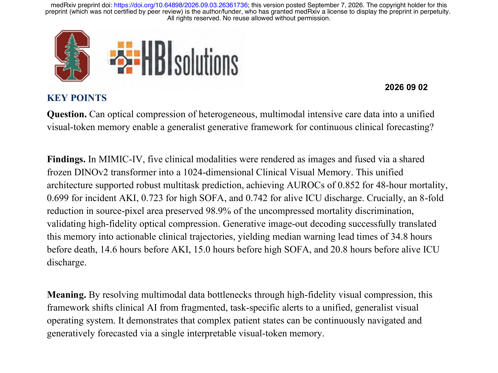
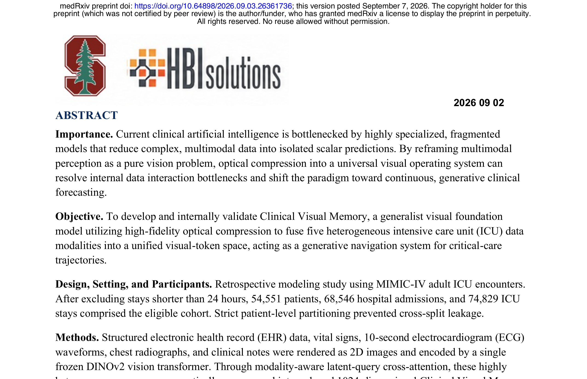
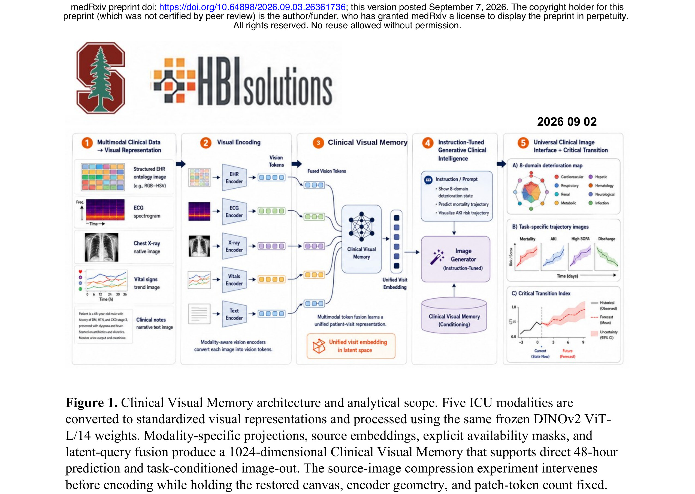
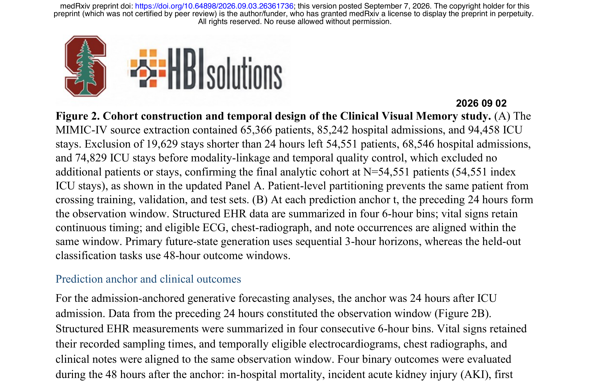
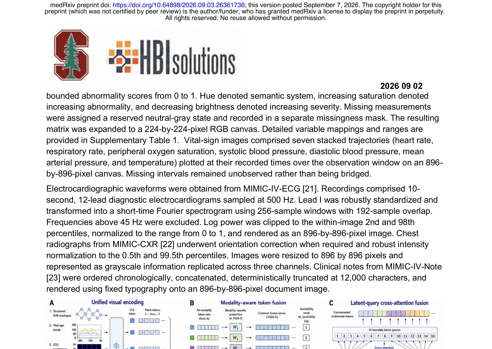

# Paper 11: Optical Compression of Multimodal Clinical Data into a Unified Visual Memory for Generative Trajectory Forecasting

## 1. Paper Title, Authors, Venue

- **Title**: Optical compression of multimodal clinical data into a unified visual memory for generative trajectory forecasting
- **Short Title**: Visual-Token Interface for ICU Forecasting
- **Authors**: Zongheng Guo, Bo Jin, Zhi Han, Takumi Ichikawa, Naoto Ozawa, Xuefeng B. Ling
- **Affiliations**: Politecnico di Milano, HBI Solutions Inc., Stanford University School of Medicine, Nippon Life Insurance Company
- **Venue**: medRxiv preprint (September 2026)
- **DOI**: 10.64898/2026.09.03.26361736

## 2. Core Problem & Motivation

### 核心问题
当前临床AI面临**多模态数据碎片化**瓶颈：结构化EHR、生命体征时间序列、ECG波形、胸片、临床笔记等五种ICU数据模态在维度、语义和缺失模式上根本不同，现有方法采用模态专用特征提取器+晚期融合，导致：
- **Token瓶颈**：长临床历史超出纵向EHR模型的上下文窗口，被迫截断
- **任务碎片化**：每个临床任务需要独立模型，产生校准漂移和警报疲劳
- **缺乏统一表示**：没有可查询的、持续的患者状态基底

### 核心假设
**视觉渲染是统一的通用接口**——医学天然通过空间排列表达意义（波形的时间形态、放射影像的解剖结构、热图的多变量状态、文档的层级结构）。通过将多模态数据渲染为2D图像，用统一的视觉Transformer编码，可以：
1. 将异构数据压缩到统一的视觉token空间
2. 用交叉注意力将大量异构输入蒸馏为紧凑的潜变量阵列
3. 实现光学压缩（8倍像素面积减少仍保留98.9%的AUROC）

## 3. Method Overview with Key Equations

### 3.1 多模态视觉输入构建
五种临床模态被转换为标准化2D图像：
- **结构化EHR**：38个临床概念 × 10个语义系统 → 224×224 RGB/HSV本体画布
- **生命体征**：7条轨迹（HR、RR、SpO2、SBP、DBP、MAP、Temp）→ 896×896像素画布
- **ECG**：10秒12导联 → STFT频谱图 → 896×896像素
- **胸片**：MIMIC-CXR → 896×896灰度图像
- **临床笔记**：按时间排序拼接 → 896×896文档图像

### 3.2 光学压缩架构
所有五种图像通过**同一个冻结的DINOv2 ViT-L/14**视觉骨干处理，保留class token和完整patch token序列（每个1024维）。

**模态感知融合**：
- 模态特定投影：LayerNorm → Linear → GELU → LayerNorm
- 学习模态嵌入保持源身份
- 显式可用性掩码（5元素二值向量）排除不可用模态
- 训练时以0.15概率进行模态dropout

**Latent-Query交叉注意力融合**：
$$Z_i = F_{\text{fusion}}(T_i^{\text{EHR}}, T_i^{\text{Vital}}, T_i^{\text{ECG}}, T_i^{\text{CXR}}, T_i^{\text{Note}}, M_i)$$
$$Z_i \in \mathbb{R}^{1024}$$

16个可学习latent query交叉注意力到拼接的多模态token，经自注意力和前馈网络，池化为1024维Clinical Visual Memory。

### 3.3 生成式预测（Image-Out Decoding）
1024维CVM条件化一个**条件指令调优图像生成器**（latent diffusion），生成包含两个面板的1024×768像素输出：
- 8域生理恶化热图
- 终点邻近轨迹（16个连续3小时视野）

### 3.4 关键几何：临界转换检测
在8维生理状态空间中，定义事件特定投影轴：
$$a_q = e_q - s_{\min}$$
$$P_q(t) = \frac{[\mu_q(t) - s_{\min}] \cdot a_q}{a_q \cdot a_q}, \quad D_{\text{axis},q}(t) = 1 - P_q(t)$$

复合临界转换指数：
$$\text{CTI}(t) = 0.50 \cdot z[-D(t)] + 0.30 \cdot z[V(t)] + 0.20 \cdot z[A(t)]$$

## 4. Key Figures Explained

### Figure 1: Clinical Visual Memory 架构总览

**说明**：五阶段流水线——(1) 多模态临床数据→视觉表示；(2) 统一视觉编码（冻结DINOv2）；(3) 模态感知融合→1024维Clinical Visual Memory；(4) 指令调优生成式图像输出；(5) 通用临床图像接口+临界转换指数。展示了从原始多模态数据到生成式临床轨迹预测的完整路径。

### Figure 2: 队列构建与时间设计

**说明**：(A) MIMIC-IV源数据提取→排除<24h ICU住院→最终54,551患者/74,829 ICU住院。患者级分区防止交叉泄漏。(B) 预测锚点=ICU入院后24h，前24h为观察窗口。结构化EHR按4个6小时bin摘要，生命体征保留连续时间。

### Figure 3: 详细架构与生成式Image-Out

**说明**：(A) 统一视觉编码——五种模态图像经同一冻结DINOv2处理。(B) 模态感知token融合——模态特定投影+学习嵌入+可用性掩码。(C) Latent-query交叉注意力——16个可学习query交叉注意力到多模态token，池化为1024维CVM。(D) 指令调优生成式image-out——CVM+任务指令→条件图像生成器→8域恶化热图+任务特定轨迹。

### Figure 4: 光学压缩保真度验证

**说明**：(A) 在100%到1%源像素面积范围内，48小时死亡率AUROC保留率。8倍压缩（12.5%面积）保留98.9%性能。(B) 各模态特定压缩行为。验证了光学压缩作为高效输入机制的鲁棒性。

### Figure 5: 临床预测与临界转换性能

**说明**：(A-D) 四个临床任务的ROC和PR曲线——48小时死亡率(AUROC 0.852)、AKI(0.699)、高SOFA(0.723)、存活ICU出院(0.742)。(E) 中位预警提前时间——死亡34.8h、AKI 14.6h、高SOFA 15.0h、出院20.8h。(F) 投影轴几何 vs 仅质心几何的敏感度比较。

## 5. Strengths & Weaknesses

### Strengths
1. **范式创新**：首次将多模态临床数据统一渲染为视觉token空间，用光学压缩解决token瓶颈
2. **高保真压缩**：8倍像素面积减少保留98.9% AUROC，证明密集临床数据可激进压缩
3. **生成式预测**：不仅预测离散事件，还生成连续8域恶化轨迹，提供可操作的临床导航
4. **计算效率**：batch size 32时1,551患者/秒，延迟0.645ms/患者
5. **多任务统一**：单一模型同时处理4个临床任务，pooled-vision消融实验证明latent-query融合优于简单池化
6. **严格验证**：患者级分区、STROBE+TRIPOD+AI报告规范、配对bootstrap置信区间

### Weaknesses
1. **仅内部验证**：仅在MIMIC-IV上验证，缺乏外部验证和前瞻性验证
2. **AUROC提升有限**：与L2正则化逻辑回归相比，AUROC差异的95% CI均包含零
3. **生成式image-out性能下降**：高SOFA任务的image-out解码AUROC显著低于直接预测头
4. **模态可用性高度碎片**：仅6.12%患者同时拥有全部5种模态，实际应用场景受限
5. **计算成本**：15epoch多任务微调需73分钟（A800 GPU），上游DINO编码和下游生成解码未计入端到端延迟
6. **临床转化距离**：回顾性研究，未证明临床决策改善或患者结局获益

## 6. Connection to Adaptive Temporal Semantics Learning

### 直接关联
1. **时间语义压缩**：本文的光学压缩思想与我们的Adaptive Temporal Semantics Learning高度互补——将长临床历史压缩为紧凑的语义表示。我们的方法可以在时间维度上实现类似的压缩，但专注于**时间语义**而非视觉像素。

2. **多模态融合**：本文的latent-query交叉注意力机制可启发我们的时间语义融合——用可学习query从多模态时间序列中提取语义，而非简单拼接。

3. **生成式轨迹预测**：本文的image-out decoding生成连续临床轨迹，与我们的生成式预测目标一致。区别在于我们预测的是**语义轨迹**而非图像轨迹。

4. **临界转换检测**：本文的投影轴几何（距离+速度+加速度复合指数）可直接应用于我们的时间语义空间，作为**自适应转换检测**的几何基础。

### 差异化定位
- 本文：视觉空间中的光学压缩 → 图像生成
- 我们：时间语义空间中的自适应压缩 → 语义轨迹生成
- 结合点：将光学压缩的latent-query机制应用于时间语义学习，实现**时间维度的高保真压缩**

### 可借鉴方法
- 模态可用性掩码机制 → 处理不规则时间序列缺失
- 8倍压缩保真度验证 → 验证时间语义压缩的信息保留
- 临界转换几何 → 自适应时间语义转换检测
