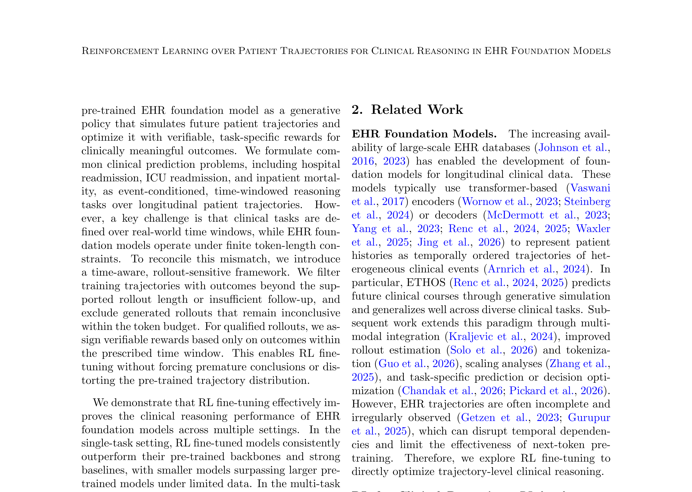
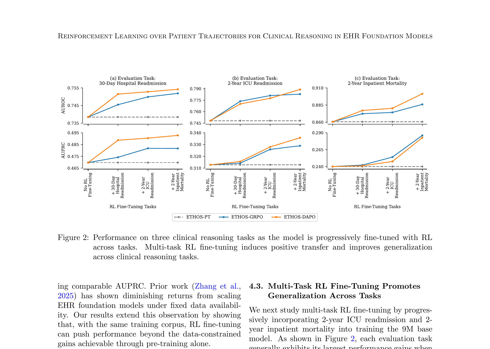
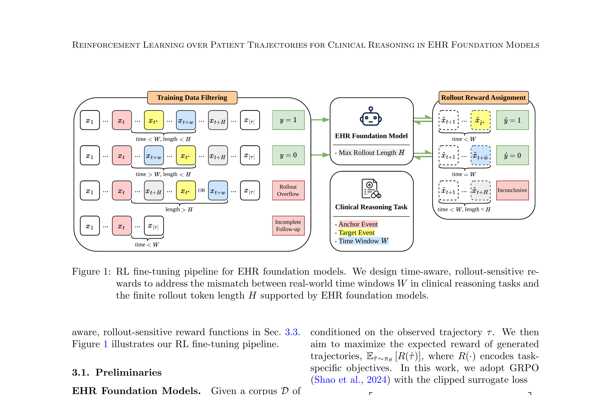

# Paper 12: Reinforcement Learning over Patient Trajectories for Clinical Reasoning in EHR Foundation Models

## 1. Paper Title, Authors, Venue

- **Title**: Reinforcement Learning over Patient Trajectories for Clinical Reasoning in EHR Foundation Models
- **Authors**: Yuxin Xiao, Sheng Zhang, Chandan Singh, Tristan Naumann, Hoifung Poon, Jianfeng Gao, Xiaodong Liu
- **Affiliations**: MIT, Microsoft Research
- **Venue**: ML4H 2026 (Proceedings Track)
- **arXiv**: 2609.12277v1 (September 2026)
- **Code**: https://github.com/xiaoyuxin1002/ETHOS-RL

## 2. Core Problem & Motivation

### 核心问题
EHR基础模型通过next-token预测在纵向患者轨迹上预训练，在多种临床预测任务上表现强劲。但存在三个关键限制：
1. **数据约束下的规模收益递减**：在固定临床数据集（MIMIC-IV）下，模型规模扩大收益递减
2. **Next-token预测不足以支持长视野推理**：临床任务需要跨越数月甚至数年的推理
3. **不完整和不规则时间线**：临床相关事件可能缺失，破坏时间依赖关系

### 核心思想
将EHR基础模型视为**生成式策略（generative policy）**，通过RL微调优化轨迹级临床推理能力。关键创新在于设计**时间感知、rollout敏感的奖励函数**，解决临床任务时间窗口与模型有限rollout长度之间的不匹配。

### 关键洞察
- 临床任务定义在真实时间窗口W上，但模型生成受token长度H限制
- 需要区分三种情况：rollout溢出（目标事件超出H）、随访不完整（记录在W前结束）、rollout不确定（生成轨迹在H内未达结论）
- 不确定的rollout不应被强制结论，否则会鼓励跳过中间事件，扭曲预训练轨迹分布

## 3. Method Overview with Key Equations

### 3.1 预训练基础
EHR基础模型（ETHOS）将患者轨迹表示为token序列：
$$\tau = (x_1, \ldots, x_{|\tau|})$$

序列包含：(1) 医学事件token，(2) 时间token（编码事件间经过时间），(3) 辅助token（静态/上下文信息）。

预训练目标——自回归next-token预测：
$$\ell_{\text{PT}} = -\mathbb{E}_{\tau \sim \mathcal{D}} \left[\sum_{t=1}^{|\tau|} \log p_\theta(x_t | x_{<t})\right]$$

### 3.2 临床推理任务形式化
每个任务由三元组定义：(1) 锚点事件 $x$，(2) 未来目标事件 $x^*$，(3) 时间视野 $W$。

三个代表性任务：
- **30天医院再入院**：锚点=出院，目标=30天内再入院
- **2年ICU再入院**：锚点=ICU出院，目标=2年内ICU入院
- **2年住院死亡率**：锚点=入院，目标=2年内死亡

标签：$y = \mathbb{1}[t^* \leq t + w]$

### 3.3 训练数据过滤
对于基础模型支持的rollout长度H，轨迹有用的条件是：
$$\min(t^*, t + w) \leq \min(t + H, |\tau|)$$

过滤两种情况：
1. **Rollout溢出**：目标事件或时间窗口边界超出H
2. **随访不完整**：记录在到达 $x^*$ 或 $W$ 前结束

### 3.4 Rollout奖励分配
对每个保留轨迹，条件化于锚点前缀，从 $\pi_\theta$ 采样多个rollout $\hat{\tau}$（最多H个token）。

**合格rollout**：到达目标事件 $x^*$ 或完整时间窗口W。
**不确定rollout**：在H内未达结论——不分配奖励也不惩罚，排除在优势归一化和策略更新之外。

对合格rollout，仅评估W内的部分：
$$\hat{y} = \mathbb{1}[\hat{t}^* \leq t + \hat{w}]$$
$$R(\hat{\tau}) = \mathbb{1}[\hat{y} = y]$$

### 3.5 RL微调（GRPO/DAPO）
采用GRPO的clipped surrogate loss：
$$\ell_{\text{GRPO}} = -\mathbb{E}_t \left[\min\left(r_t(\theta) \hat{A}_t, \text{clip}(r_t(\theta), 1 \pm \epsilon) \hat{A}_t\right)\right]$$

其中 $r_t(\theta) = \frac{\pi_\theta(x_t | x_{<t})}{\pi_{\theta_{\text{old}}}(x_t | x_{<t})}$，$\hat{A}_t$ 通过对同一上下文的rollout进行组归一化奖励估计。

DAPO扩展了非对称裁剪和动态采样。

## 4. Key Figures Explained

### Figure 1: RL微调流水线

**说明**：展示了完整的RL微调流程——从EHR基础模型出发，经过训练数据过滤（处理rollout溢出和随访不完整），到rollout奖励分配（区分合格/不确定rollout），最终通过GRPO/DAPO优化策略。核心创新是时间感知、rollout敏感的奖励设计。

### Figure 2: 多任务RL性能

**说明**：三个临床推理任务上的性能对比——随着模型逐步在多个任务上RL微调，性能持续提升。多任务RL产生正向迁移，改善了跨任务泛化。9M ETHOS-DAPO超越56M ETHOS-PT，证明RL微调可超越数据约束下的模型规模扩展。

### Figure 3: 方法细节

**说明**：展示了时间感知奖励的具体实现——rollout长度H、时间窗口W、锚点事件、目标事件之间的关系，以及不确定rollout的处理机制。

## 5. Strengths & Weaknesses

### Strengths
1. **范式创新**：首次将RL微调系统性地应用于EHR基础模型的轨迹级临床推理
2. **时间感知奖励**：巧妙解决临床时间窗口与有限rollout长度的不匹配，不确定rollout不强制结论
3. **小模型超越大模型**：9M ETHOS-DAPO在AUROC上超越56M ETHOS-PT，证明RL微调可替代数据约束下的规模扩展
4. **多任务正向迁移**：联合RL微调在多个临床任务间产生正向迁移
5. **生成轨迹质量提升**：RL微调模型生成的轨迹在结构和语义上更好对齐真实轨迹，具有更高下游预测效用
6. **校准改善**：期望校准误差从0.0823降至0.0325（GRPO）/0.0388（DAPO）

### Weaknesses
1. **仅MIMIC-IV验证**：单一数据集，未验证跨机构泛化
2. **任务数量有限**：仅3个临床推理任务，未覆盖更广泛的临床场景
3. **Rollout采样成本**：每个测试样本需20个随机rollout，推理成本较高
4. **奖励设计简单**：二元奖励（正确/不正确），未考虑预测置信度或校准
5. **基础模型依赖**：需要预训练的EHR基础模型（ETHOS），不是通用方案
6. **缺乏临床效用验证**：未证明RL微调模型的临床决策改善

## 6. Connection to Adaptive Temporal Semantics Learning

### 直接关联
1. **轨迹级优化**：本文将患者轨迹作为RL的基本单位，与我们的Adaptive Temporal Semantics Learning的轨迹级语义学习高度一致。RL微调可优化时间语义的生成策略。

2. **时间感知奖励**：本文的时间感知、rollout敏感奖励设计可直接应用于我们的时间语义学习——当预测的时间语义轨迹与真实轨迹在时间窗口W内对齐时给予奖励。

3. **不确定轨迹处理**：本文对不确定rollout不强制结论的思想，可启发我们的时间语义学习——对于时间信息不完整的患者，不强制生成确定性预测。

4. **多任务迁移**：本文证明多任务RL产生正向迁移，支持我们在多个临床任务上联合优化时间语义学习。

### 差异化定位
- 本文：RL微调优化EHR基础模型的next-token预测策略
- 我们：自适应时间语义学习优化时间维度的语义表示和转换
- 结合点：将RL微调应用于时间语义生成策略，用时间感知奖励优化语义轨迹的临床推理

### 可借鉴方法
- Rollout敏感奖励 → 时间语义轨迹的窗口对齐奖励
- 训练数据过滤 → 时间语义学习中的不完整轨迹过滤
- GRPO/DAPO → 时间语义生成策略的RL优化
- 多任务联合微调 → 多临床任务的时间语义联合学习
