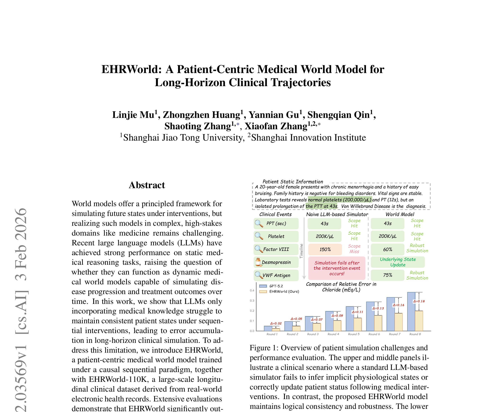
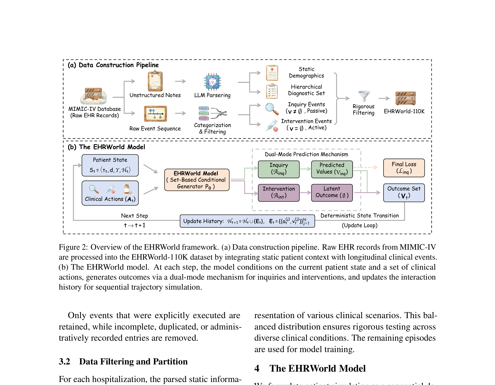
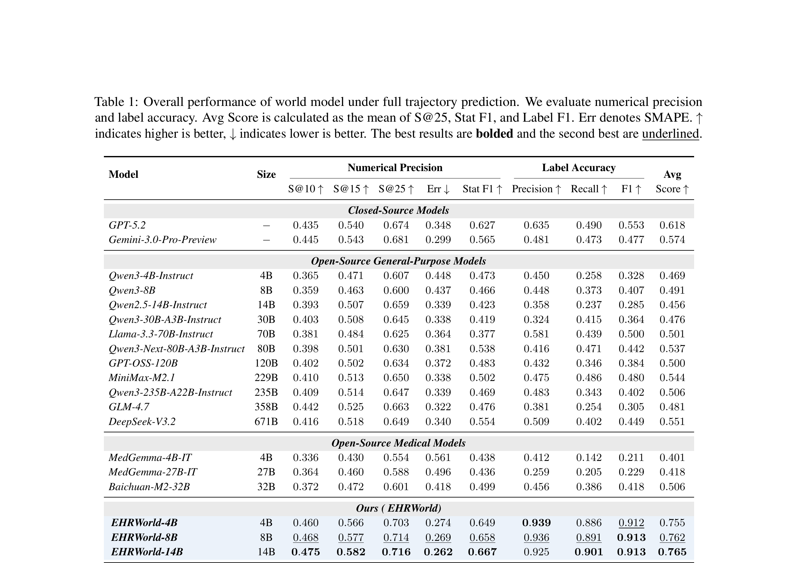
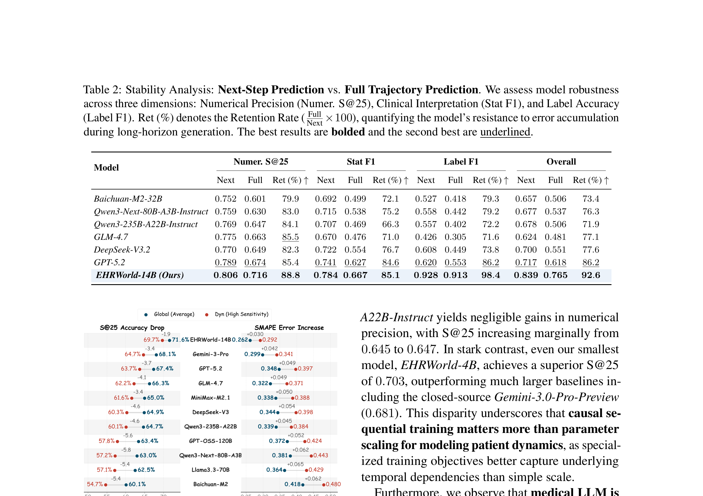

# Paper 13: EHRWorld - A Patient-Centric Medical World Model for Long-Horizon Clinical Trajectories

## 1. Paper Title, Authors, Venue

- **Title**: EHRWorld: A Patient-Centric Medical World Model for Long-Horizon Clinical Trajectories
- **Authors**: Linjie Mu, Zhongzhen Huang, Yannian Gu, Shengqian Qin, Shaoting Zhang, Xiaofan Zhang
- **Affiliations**: Shanghai Jiao Tong University, Shanghai Innovation Institute
- **Venue**: arXiv preprint (February 2026)
- **arXiv**: 2602.03569v1

## 2. Core Problem & Motivation

### 核心问题
LLM在静态医学推理任务上表现强劲，但作为**动态医学世界模型**时存在根本缺陷：
1. **无法维持一致的患者状态**：在顺序干预下，LLM内部无法跟踪潜在生理状态
2. **误差累积**：多步交互中误差不断累积，缺乏显式的状态跟踪机制
3. **缺乏因果基础**：LLM仅包含医学知识，未在因果接地、时间演化的临床数据上训练

### 核心洞察
LLM能准确复制单个时间点的临床观察，但在以下情况失败：
- 推断隐含生理状态（如从正常血小板和PT推断PTT延长原因）
- 在医疗干预后正确更新患者状态（如给予去氨加压素后VWF抗原变化）

### 解决方案
构建**EHRWorld**——一个患者中心的医学世界模型，在因果顺序范式下训练，能：
- 显式跟踪和更新患者状态
- 在顺序临床干预下维持逻辑一致性
- 支持长视野临床轨迹模拟

## 3. Method Overview with Key Equations

### 3.1 数据构建：EHRWorld-110K
从MIMIC-IV原始EHR记录构建，三阶段流水线：
1. **解析非结构化临床笔记**：用LLM（Qwen3-235B-A22B-Instruct）提取患者级静态信息（人口统计学、层级诊断集）
2. **处理原始事件序列**：提取时间戳临床事件，组织为覆盖整个住院的事件序列
3. **整合**：将患者档案与事件序列在住院episode级别整合，严格时间排序

**事件分类**：
- **查询事件（Inquiry）**：被动观察患者状态（实验室检查、体格检查），产生显式测量值
- **干预事件（Intervention）**：主动临床行动（药物、操作），旨在改变患者状态

**数据规模**：110,513个住院episode，约1750万个临床事件。

### 3.2 患者状态表示
$$S_t = \langle \tau_t, d, Y, H_t \rangle$$

其中：
- $\tau_t$：当前生理时间戳
- $d$：静态人口学属性
- $Y$：当前住院episode的诊断档案（含主要和次要诊断及临床原理）
- $H_t = \{E_1, \ldots, E_{t-1}\}$：交互历史

### 3.3 基于集合的条件生成
临床实践常同时发出多个医嘱。EHRWorld将临床交互建模为**基于集合的条件生成**：

$$A_t = \{a_t^{(1)}, \ldots, a_t^{(N)}\}, \quad V_t = \{v_t^{(1)}, \ldots, v_t^{(N)}\}$$

$$P_\theta(V_t | S_t, A_t) = \prod_{j=1}^{N} P_\theta(v_t^{(j)} | S_t, A_t)$$

### 3.4 双模式预测机制
**查询模式**：对查询动作 $a_t \in \mathcal{A}_{\text{inq}}$，预测显式可观察值：
$$\mathcal{L}_{\text{inq}} = -\sum_{j: a_t^{(j)} \in \mathcal{A}_{\text{inq}}} \log P_\theta(v_{\text{gt}}^{(j)} | S_t, A_t)$$

**干预模式**：对干预动作 $a_t \in \mathcal{A}_{\text{int}}$，不生成即时可观察值（$P_\theta(v_t = \emptyset) = 1$），而是记录到患者历史中更新模拟上下文。

### 3.5 确定性状态转移
$$H_{t+1} = H_t \cup \{E_t\}, \quad S_{t+1} = \langle \tau_{t+1}, d, Y, H_{t+1} \rangle$$

### 3.6 模型训练
基于Qwen3-4B/8B和Qwen2.5-14B微调，3个epoch，8×H100 GPU，DeepSpeed ZeRO-2，学习率1e-6，cosine decay，causal masking。

## 4. Key Figures Explained

### Figure 1: 患者模拟挑战与性能评估概述

**说明**：上半部分展示临床场景——标准LLM模拟器无法推断隐含生理状态或在干预后正确更新患者状态。下半部分展示8轮模拟中氯离子相对误差轨迹，EHRWorld显著约束误差传播速率，与GPT-5.2的性能差距不断扩大。

### Figure 2: EHRWorld框架概述

**说明**：(A) 数据构建流水线——MIMIC-IV原始EHR记录→LLM解析非结构化笔记+事件序列分类过滤→EHRWorld-110K数据集。(B) EHRWorld模型——每步条件化于当前患者状态和临床动作集合，通过双模式机制生成结果，更新交互历史用于顺序轨迹模拟。

### Figure 3: 数值精度与标签准确率结果

**说明**：全轨迹预测的数值精度（S@10/S@15/S@25）和标签准确率（Stat F1、Label F1）对比。EHRWorld-14B在数值精度和标签准确率上显著优于GPT-5.2和Gemini-3.0-Pro等闭源模型。

### Figure 4: 长视野模拟稳定性

**说明**：长视野临床模拟中的误差累积对比。EHRWorld在8轮模拟中保持低误差率，而基线模型误差持续累积。展示了EHRWorld在临床敏感事件上的稳定性和推理效率优势。

## 5. Strengths & Weaknesses

### Strengths
1. **范式创新**：首次将世界模型概念引入EHR领域，构建患者中心的医学世界模型
2. **大规模高质量数据**：EHRWorld-110K包含110K episode、1750万事件，从真实EHR构建
3. **因果顺序训练**：在因果接地、时间演化的临床数据上训练，而非仅医学知识
4. **双模式机制**：区分查询和干预事件，符合临床实践语义
5. **长视野稳定性**：显著减少误差累积，在8轮模拟中保持逻辑一致性
6. **小模型超越大模型**：EHRWorld-4B在部分指标上超越GPT-5.2

### Weaknesses
1. **仅MIMIC-IV数据**：单一来源，未验证跨机构泛化
2. **评估指标局限**：主要评估数值精度和标签准确率，缺乏临床结局评估
3. **干预效果建模不足**：干预事件仅更新上下文，未显式建模干预的因果效应
4. **计算成本**：14B模型需8×H100 GPU训练，推理成本较高
5. **缺乏临床验证**：未证明模拟结果与真实临床结局的一致性
6. **事件分类简单**：仅区分查询和干预，未细分更细粒度的临床事件类型

## 6. Connection to Adaptive Temporal Semantics Learning

### 直接关联
1. **状态跟踪与更新**：本文的显式患者状态表示 $S_t = \langle \tau_t, d, Y, H_t \rangle$ 与我们的时间语义状态表示高度相关。我们的Adaptive Temporal Semantics Learning可学习类似的状态表示，但专注于**时间语义维度**。

2. **因果顺序范式**：本文在因果接地、时间演化的数据上训练，与我们的时间语义学习的时间因果性一致。时间语义的转换应遵循因果顺序。

3. **双模式机制**：本文区分查询（观察）和干预（行动）的模式，可启发我们的时间语义学习——区分**观察性语义更新**和**干预性语义转换**。

4. **长视野模拟**：本文的长视野临床轨迹模拟目标与我们的时间语义轨迹生成目标一致。我们的方法可生成语义级别的轨迹，而非仅数值级别。

### 差异化定位
- 本文：数值级别的患者状态模拟（实验室值、诊断标签）
- 我们：语义级别的时间语义表示和转换
- 结合点：将EHRWorld的状态跟踪机制应用于时间语义空间，实现**语义级别的长视野临床轨迹模拟**

### 可借鉴方法
- 患者状态表示 → 时间语义状态表示
- 双模式预测 → 观察性/干预性时间语义更新
- 确定性状态转移 → 时间语义的因果转换
- EHRWorld-110K数据集 → 时间语义学习的训练数据
- 长视野误差控制 → 时间语义轨迹的误差约束
