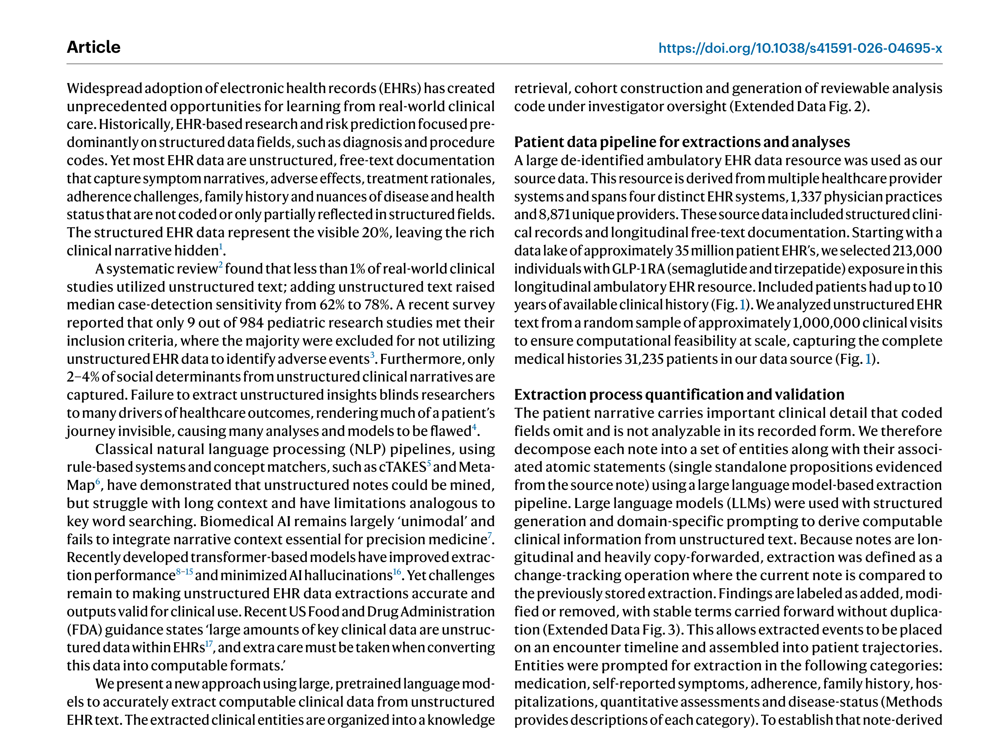

# Paper 14: Computable Longitudinal Patient Journeys from Structured and Unstructured EHR Data

## 1. Paper Title, Authors, Venue

- **Title**: Computable longitudinal patient journeys from structured and unstructured EHR data
- **Authors**: Edward Kim, Richard Foty, Avnesh S. Thakor, Jay S. Skyler, Lucy F. Robinson, James D. Park, Monica Kraft, Charles B. Cairns, Vicki Seyfert-Margolis
- **Affiliations**: Respond Health, University of California San Diego, University of Miami, University of North Carolina, University of Virginia, University of Arizona
- **Venue**: Nature Medicine (2026)
- **DOI**: 10.1038/s41591-026-04695-x

## 2. Core Problem & Motivation

### 核心问题
EHR数据的**80%是非结构化文本**（临床笔记），但大多数真实世界证据研究仅依赖结构化数据字段。这导致：
1. **患者旅程不可见**：症状叙述、不良反应、治疗原理、依从性挑战、家族史等关键信息未被编码
2. **病例检测灵敏度低**：仅用结构化数据时中位灵敏度62%，加入非结构化文本后提升至78%
3. **社会决定因素缺失**：仅2-4%的社会决定因素从非结构化叙述中捕获
4. **经典NLP管线局限**：基于规则的系统（cTAKES、MetaMap）在长上下文上表现不佳，类似关键词搜索

### 核心方案
使用**大型预训练语言模型**从非结构化EHR文本中准确提取可计算临床数据，结合结构化EHR数据，嵌入医学本体，组织为**知识图谱（KG）**，并通过**智能体友好程序接口**实现大规模查询分析。

### 关键创新
- **变更追踪提取**：将提取定义为变更追踪操作——当前笔记与先前存储的提取比较，标记为added/modified/removed
- **数据驱动分类法**：对标准术语未覆盖的患者中心概念，从笔记中直接派生分组
- **智能体分析环境**：研究智能体检索子图、起草分析计划、编写代码、构建中间数据结构

## 3. Method Overview with Key Equations

### 3.1 数据管线
**数据源**：多医疗系统、1,337个医生诊所、8,871个独特提供者的去标识化门诊EHR数据。

**队列选择**：
- 3512万患者 → 253万活跃成人 → 21.3万GLP-1暴露成人 → 54,277有基线数据 → 31,235完整提取队列

### 3.2 提取管线
使用LLM（GPT-5.2）进行结构化生成和领域特定提示，从非结构化文本中提取可计算临床信息。

**变更追踪**：
- 当前笔记 vs 先前存储提取
- 标记为added/modified/removed
- 稳定术语无重复地向前携带

**提取类别**：药物、自报症状、依从性、家族史、住院、定量评估、疾病状态

### 3.3 验证结果
**对医生参考标准的验证**（100个临床访问，96个提供者，86个诊所，4个EHR系统）：
- 总体F1：99.4%（精确率99.2%，召回率99.6%）
- 药物F1：98.9%
- 表型和发现F1：99.5%
- 定量评估F1：100%

**与其他模型对比**（20个访问）：
- GPT-5.2 Low表型精确率：99.5%（PhenoTagger仅15.3%，83.4%为否定错误）
- GPT-5.2 Low药物精确率：95.5%（BioNER 81.6%，BERT Large Med NER 65.4%）

### 3.4 知识图谱构建
**KG规模**：8800万节点，2.41亿边，映射到58,000+ UMLS概念、8,736 HPO概念、39,827独特药物。

**节点类型**：患者、访问、本体概念、临床实体（来自结构化记录和非结构化笔记）

**边类型**：时间关系 + 语义关系，每个元素保留源链接

**关键特性**：
- 每个元素链接到源证据、访问元数据、断言/否定状态、验证级别
- 每个元素接地到参考术语（HPO、UMLS、RxNorm）或数据驱动分类法
- 检索、接地和图构建步骤由生成可复现代码的智能体执行

### 3.5 临床应用于GLP-1 RA
**分析队列**：25,092名GLP-1 RA启动患者（司美格鲁肽和替尔泊肽）

**纵向分析**：
- 识别GLP-1 RA启动患者
- 纵向对齐笔记衍生和结构化观察
- 重建患者级轨迹
- 纵向建模体重和HbA1c变化
- 时间到事件分析（超越固定时间点终点）

## 4. Key Figures Explained

### Figure 1: 队列选择流程图

**说明**：从3512万患者数据湖开始，逐步筛选：活跃成人（≥5次临床访问）→ GLP-1暴露成人 → 有基线数据（HbA1c和体重在-60到+14天内）→ 完整提取队列（100万访问样本）→ 最终分析队列（体重16,061人，HbA1c 14,788人）。展示了从大规模EHR到精确分析队列的完整筛选路径。

### Figure 2: 概念发现与知识图谱

**说明**：(A) 数据驱动分类法发现——从药物切换原因等患者中心概念中，通过嵌入聚类发现简洁可复用的分组。(B) 知识图谱结构——添加非结构化变量显著增加患者KG的规模、密度和复杂度。(C) 患者级旅程重建——链接源证据和不确定性量化元数据。

### Figure 3: GLP-1 RA治疗反应结果

**说明**：GLP-1 RA启动后的纵向体重和HbA1c变化轨迹。展示了从非结构化笔记中提取的临床实体如何与结构化EHR数据整合，重建患者级纵向轨迹，揭示治疗反应关联。

### Figure 4: 时间到事件分析

**说明**：超越固定时间点终点的时间到事件分析。展示了仅从非结构化临床笔记中捕获的结果，提供真实世界治疗反应的全面理解。

## 5. Strengths & Weaknesses

### Strengths
1. **临床验证严格**：医生裁决参考标准，F1达99.4%，多医生交叉验证和裁决
2. **规模空前**：3512万患者数据湖，21.3万GLP-1暴露患者，8800万节点KG
3. **疾病无关框架**：不特定于某种疾病，可扩展到所有临床条件
4. **变更追踪提取**：创新性地将提取定义为变更追踪，处理纵向copy-forward笔记
5. **智能体友好接口**：程序化接口支持大规模KG查询，研究智能体生成可复现代码
6. **临床效用证明**：GLP-1 RA纵向分析展示真实世界治疗反应，时间到事件分析
7. **非结构化数据价值**：证明添加非结构化文本显著增加KG规模、密度和复杂度

### Weaknesses
1. **仅门诊EHR**：数据源为门诊EHR，未涵盖住院数据
2. **GLP-1 RA单一应用**：临床效用仅在一类药物上验证，未展示其他疾病领域
3. **LLM依赖**：提取依赖GPT-5.2，成本和可复现性受限
4. **验证集小**：医生验证仅100个访问，可能不足以覆盖所有临床场景
5. **KG复杂性**：8800万节点、2.41亿边的KG查询效率可能受限
6. **缺乏预测模型**：主要展示描述性分析，未构建预测模型
7. **时间分辨率**：变更追踪可能丢失精确时间信息

## 6. Connection to Adaptive Temporal Semantics Learning

### 直接关联
1. **纵向患者旅程重建**：本文的患者级旅程重建与我们的Adaptive Temporal Semantics Learning的轨迹生成目标高度一致。我们的方法可学习时间语义级别的患者旅程表示。

2. **变更追踪提取**：本文的变更追踪（added/modified/removed）思想可直接应用于时间语义学习——追踪患者状态随时间的变化，标记语义转换点。

3. **知识图谱集成**：本文将结构化和非结构化数据整合到KG中，与我们的多模态时间语义融合目标一致。KG可作为时间语义学习的结构化知识基底。

4. **时间到事件分析**：本文超越固定时间点终点的时间到事件分析，与我们的时间语义转换检测目标一致。我们的方法可预测语义级别的时间到事件。

5. **数据驱动分类法**：本文从笔记中派生数据驱动分类法，可启发我们的时间语义学习——从临床事件中发现语义模式。

### 差异化定位
- 本文：从非结构化文本提取可计算实体 → KG构建 → 描述性分析
- 我们：从多模态时间序列学习时间语义 → 自适应表示 → 预测性轨迹生成
- 结合点：将本文的变更追踪和KG构建作为时间语义学习的输入，实现**从非结构化文本到预测性时间语义轨迹**的转化

### 可借鉴方法
- 变更追踪提取 → 时间语义变更点检测
- 知识图谱结构 → 时间语义的知识接地
- 智能体分析环境 → 时间语义学习的自动化分析
- 数据驱动分类法 → 时间语义模式发现
- 时间到事件分析 → 时间语义转换预测
- 医生验证框架 → 时间语义学习的临床验证标准
