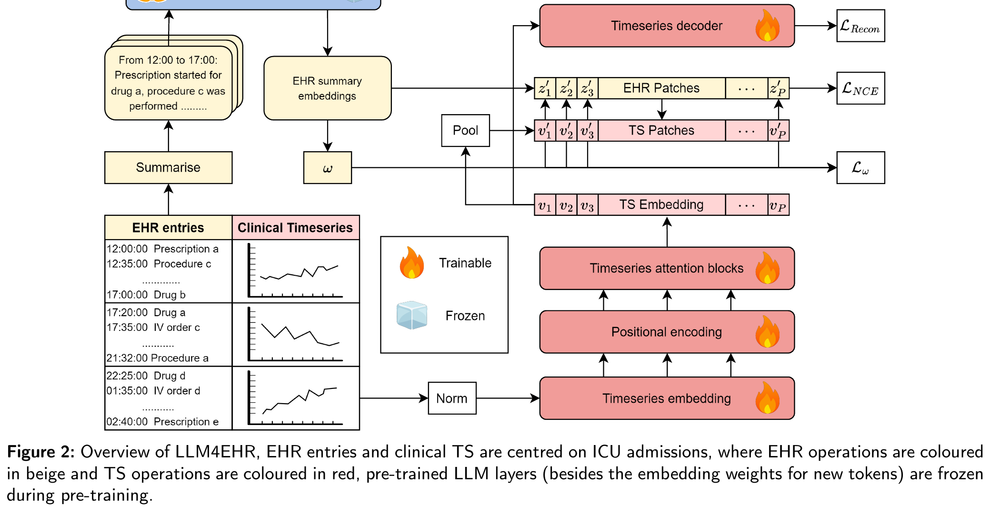
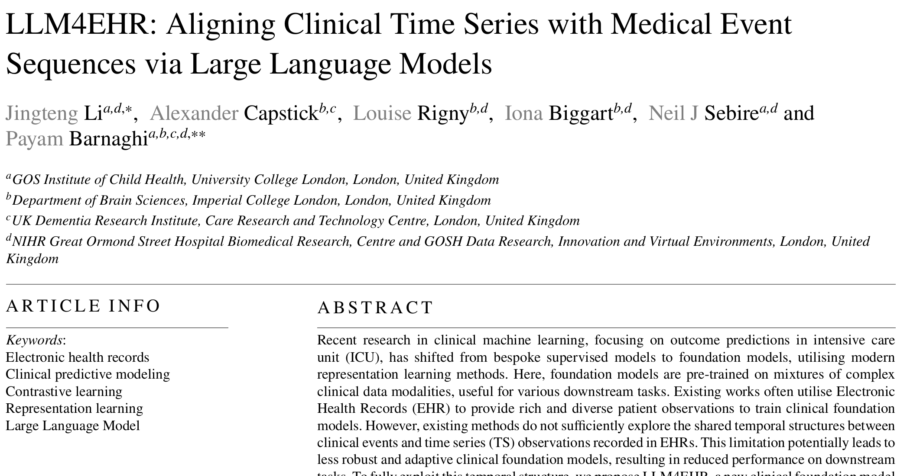
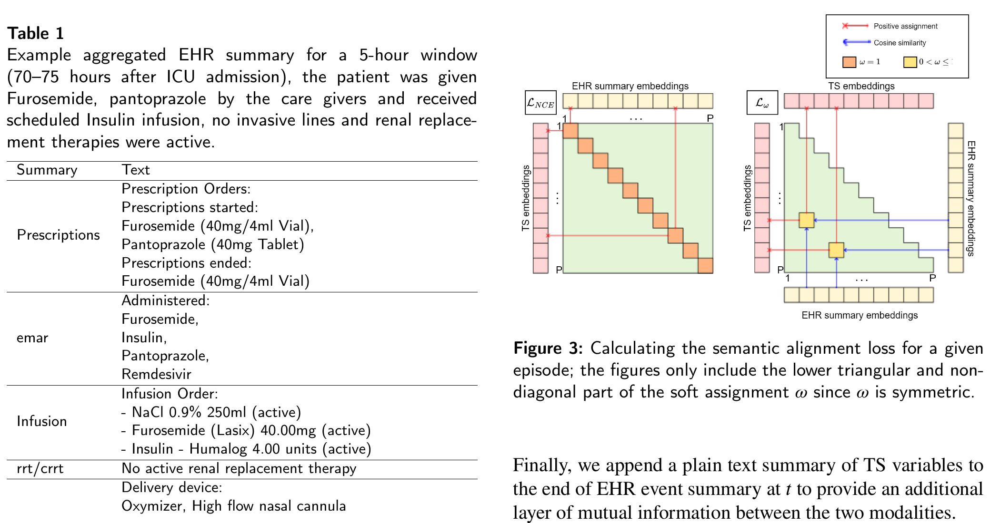
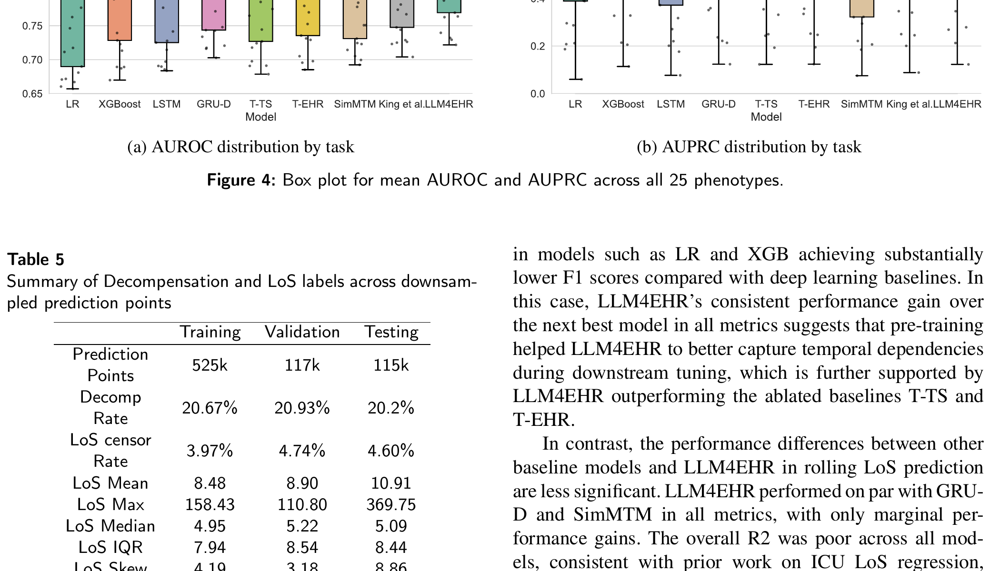
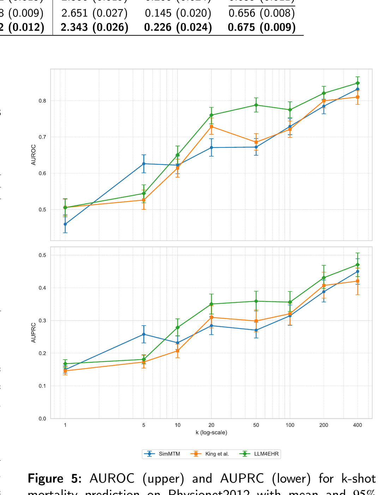

# LLM4EHR 论文详细分析

## 1. 论文基本信息

- **论文标题**: LLM4EHR: Aligning Clinical Time Series with Medical Event Sequences via Large Language Models
- **作者**: Jingteng Li, Alexander Capstick, Louise Rigny, Iona Biggart, Neil J Sebire, Payam Barnaghi
- **机构**: University College London (UCL), Imperial College London, UK Dementia Research Institute, NIHR Great Ormond Street Hospital
- **发表venue**: arXiv preprint (arXiv:2607.15447v1), 2026年7月16日, 投稿至Elsevier
- **代码**: https://github.com/CrankyWilliam/LLM4EHR

---

## 2. 核心问题与动机

### 2.1 问题背景

电子健康记录（EHR）数据本质上是多模态的，包含两种核心数据类型：
- **EHR事件（Events）**: 不规则采样的临床交互记录，如药物处方、输液医嘱、氧疗设置、侵入性管路操作等
- **EHR时间序列（TS）**: 常规采集的患者监测数据，如生命体征（心率、血压、血氧等）和实验室检查指标

### 2.2 核心问题

现有临床基础模型方法存在以下关键局限：

1. **单模态建模**: 现有方法要么只建模EHR事件序列（如Foresight、ETHOS），要么只建模EHR TS（如LLM4TS、AutoTimes），未能充分利用两种模态间的互补信息

2. **静态对齐不足**: 现有的跨模态对齐方法（如King et al.）在序列级别进行"静态"对齐，忽略了细粒度的时间结构差异。临床笔记与TS之间存在时间粒度不匹配的问题

3. **语义知识未利用**: 预训练LLM中蕴含的丰富语义知识未被有效迁移到TS表示学习中

4. **类别碰撞问题**: 标准InfoNCE损失在对比学习中存在类别碰撞问题——语义相似的实例被错误地推远

### 2.3 核心假设

> **关键假设**: EHR事件和EHR TS虽然通过不同过程生成，但在时间上是对齐的。通过在预训练阶段显式对齐这两种模态，可以让TS编码器学习到更具信息量和泛化能力的EHR TS表示。

---

## 3. 方法概述

### 3.1 LLM4EHR架构

**图2**: LLM4EHR整体架构。EHR条目和临床TS以ICU入院为中心，EHR操作为米色，TS操作为红色，预训练LLM层（除新token的embedding权重外）在预训练期间冻结。

架构核心组件：
- **EHR事件编码器**: 使用领域适应的BioClinical ModernBERT（150M参数，8192上下文长度）对聚合的EHR事件摘要进行编码
- **TS编码器**: 8层自回归Transformer，8个注意力头，隐藏维度512，包含1D卷积嵌入层、可训练位置编码和自回归注意力块
- **投影层**: 全连接层，用于将LLM嵌入映射到TS编码器的特征空间，使用大动量（m=0.9）更新

### 3.2 数据表示

- **临床TS**: $x^{1:T} = \{x^1, x^2, \cdots, x^T\}$, $x^t \in \mathbb{R}^L$，其中$L=32$个生理和实验室变量
- **EHR事件序列**: $k^{1:T} = \{k_{n_1}^1, k_{n_2}^2, \cdots, k_{n_T}^T\}$，其中$k_{n_t}^t \in \mathcal{K}$是在时间步$t$观察到的$n_t$个临床事件的集合
- **完整episode**: $e_i = (x_i^{1:T_i}, k_i^{1:T_i})$，以ICU入院为中心

### 3.3 关键方程

#### 标准InfoNCE损失（方程1-2）

$$\mathcal{L}_{\text{NCE}} = -\sum_{t=1}^{T} \log \frac{\exp(\text{sim}(v^t, z^t)/\tau)}{\sum_{t' \in T \setminus t} \exp(\text{sim}(v^t, z^{t'})/\tau)}$$

$$\text{sim}(v^t, z^t) = \frac{v^t \cdot z^t}{\|v^t\| \|z^t\|}$$

其中$v^t$是TS嵌入，$z^t$是EHR事件嵌入，$\tau$是温度参数。

#### ω-正则化InfoNCE损失（方程3-4）

$$\mathcal{L}_{\omega} = -\sum_{t=1}^{T} \sum_{t^*=1, t^*<t}^{T} \omega_{t,t^*} \log \frac{\exp(\text{sim}(v^t, v^{t*})/\tau)}{\sum_{t' \in T \setminus t} \exp(\text{sim}(v^t, v^{t'})/\tau)}$$

$$\omega_{t,t^*} = \frac{\exp(\text{sim}(z^t, z^{t*}))}{\sum_{t' \in T \setminus t} \exp(\text{sim}(z^t, z^{t'}))}$$

**核心思想**: 利用LLM嵌入的语义相似度$\omega_{t,t^*}$来加权TS嵌入之间的相似度，使对应相似EHR事件的TS观测在嵌入空间中保持接近，从而缓解类别碰撞问题。

#### 总对齐目标（方程5）

$$\mathcal{L}_{\text{align}} = \mathcal{L}_{\text{NCE}} + \mathcal{L}_{\omega}$$

#### 总预训练目标（方程6）

$$\mathcal{L}_{\text{total}} = \mathcal{L}_{\text{align}} + \mathcal{L}_{\text{recon}} = \mathcal{L}_{\text{align}} + \frac{1}{T}\sum_{t=2}^{T} \|x_i^t - \hat{x}_i^t\|_2^2$$

重建损失作为辅助目标，帮助TS编码器学习更好的表示。

### 3.4 时间对齐策略

- 使用5小时bin宽度聚合EHR事件（MIMIC-IV中每小时对齐效果不佳）
- TS变量在每个时间步内用窗口特征聚合（mean, min, max, std, count）
- 在EHR事件摘要末尾附加TS变量的纯文本摘要，提供额外的互信息

---

## 4. 关键图表解释

### 4.1 图1: EHR数据示例与对比目标

**图1**: a) EHR TS示例——展示心率、收缩压、舒张压、平均血压和FiO2随时间变化；b) EHR事件示例——展示药物处方和动脉管路放置等不规则事件；c) 正则化对比目标与InfoNCE目标的差异——我们的目标通过语义相似度矩阵ω来加权TS嵌入之间的吸引。

### 4.2 图2: LLM4EHR架构

**图2**: LLM4EHR完整架构图。左侧为EHR事件处理流程（米色）：EHR条目→摘要→LLM嵌入→投影层→ω矩阵；右侧为TS处理流程（红色）：临床TS→归一化→TS嵌入→位置编码→TS注意力块→TS嵌入。顶部显示L_NCE和L_ω两个损失分量，以及重建损失L_Recon。

### 4.3 图3: 语义对齐损失计算

**图3**: 语义对齐损失的计算过程。展示EHR摘要嵌入和TS嵌入之间的软分配矩阵ω（仅显示下三角和非对角部分，因为ω是对称的）。红色箭头表示正样本分配，蓝色箭头表示余弦相似度。

### 4.4 图4: 表型预测结果分布

**图4**: 25种表型预测的AUROC和AUPRC箱线图。LLM4EHR（绿色）在所有表型上均表现最优，尤其在低患病率表型上优势明显。

### 4.5 图5: K-shot死亡率预测

**图5**: Physionet2012上的k-shot死亡率预测结果。LLM4EHR（绿色）在k≥10后超越SimMTM（蓝色）和King et al.（橙色），并在中高k值设置中保持稳定领先。

---

## 5. 实验结果总结

### 5.1 数据集

| 数据集 | 训练患者数 | 验证患者数 | 测试患者数 | 平均ICU时长 | 死亡率率 |
|--------|-----------|-----------|-----------|------------|---------|
| MIMIC-IV | 23,781 | 5,096 | 5,096 | ~145小时 | 15.4% |
| Physionet2012 | 4,000 | N/A | 4,000 | 48小时 | 14.0% |

### 5.2 主要结果

**表型预测（Table 4）**:
- LLM4EHR在全部25种表型上AUROC=0.844，AUPRC=0.610，显著优于所有基线
- 在低患病率表型（Pr<10%）上AUPRC提升3.38%，对罕见表型更鲁棒

**滚动预测（Table 6）**:
- 失代偿预测：AUROC=0.876，AUPRC=0.723，F1=0.632，全面领先
- LoS预测：MAE=2.343，R²=0.226，C-index=0.675，边际提升

**死亡率预测（Table 7）**:
- MIMIC-IV: AUROC=0.870，AUPRC=0.542
- Physionet2012（跨数据集）: AUROC=0.856，AUPRC=0.495，展现良好泛化性

### 5.3 消融实验

**预训练目标消融（Table 8）**:
- 仅L_recon: 性能最差，说明对比对齐是核心
- 仅L_NCE: 有明显提升但不如组合
- L_recon + L_NCE: 进一步提升
- L_align（完整）: 最优，ω正则化带来边际但一致的增益

**LLM选择（Table 9-10）**:
- 领域适应LLM（BioClinical ModernBERT、Clinical-Longformer）显著优于通用LLM
- 长上下文LLM优于短上下文LLM
- BioClinical ModernBERT是最佳选择

**温度参数（Table 11）**:
- τ=0.02在大多数任务上表现最优
- τ<0.08时L_ω主导L_align，导致训练不稳定

---

## 6. 优势与不足

### 6.1 优势

1. **创新的时间对齐目标**: 提出的ω-正则化InfoNCE目标首次在对比学习中引入LLM语义相似度来加权TS嵌入，有效缓解类别碰撞

2. **强泛化能力**: 跨数据集（MIMIC-IV→Physionet2012）的k-shot适应实验证明学习到的TS表示具有良好的可迁移性

3. **全面的评估**: 在4个临床任务（死亡率、表型、失代偿、LoS）上进行了系统评估，并与8个基线模型对比

4. **领域适应LLM的有效利用**: 证明了领域适应LLM（BioClinical ModernBERT）在EHR事件编码中的关键作用

5. **详细的消融实验**: 对预训练目标、LLM选择、温度参数等进行了全面的消融分析

### 6.2 不足

1. **可扩展性受限**: 论文承认难以扩展到更大的语言模型，因为对比学习需要大量内存。未使用memory queue等高效对比学习结构

2. **仅限ICU数据**: 预训练仅基于ICU episode，未建模跨多次住院的长期患者轨迹，限制了其在长期护理监测等任务上的应用

3. **EHR事件类型有限**: 仅使用了处方、输液、氧疗、侵入性管路和RRT/CRRT等事件类型，未包含临床笔记、影像报告等更丰富的模态

4. **LoS预测性能一般**: R²仅0.226，虽然优于基线但绝对值较低，说明精确预测出院时间仍然困难

5. **计算成本**: 需要预计算EHR嵌入，且对比学习在大规模数据上的计算开销较大

6. **缺乏临床可解释性**: 未分析学习到的TS表示的临床意义，如哪些时间步或变量对预测贡献最大

---

## 7. 与Adaptive Temporal Semantics Learning的联系

### 7.1 核心共鸣点

LLM4EHR与我们的Adaptive Temporal Semantics Learning（ATSL）研究思路存在以下重要共鸣：

1. **时间语义对齐的核心思想**: 两者都认识到EHR中不同模态/变量间存在共享的时间结构，需要显式建模这种时间对齐关系。LLM4EHR通过对比目标对齐事件和TS，ATSL则可能通过自适应的时间语义学习来捕捉更细粒度的时间依赖

2. **语义知识迁移**: LLM4EHR利用LLM的语义相似度来指导TS表示学习，这与ATSL中利用语义信息来增强时间序列建模的思路一致。我们可以借鉴其ω-正则化的思想，在ATSL中引入类似的自适应语义加权机制

3. **类别碰撞问题的解决**: LLM4EHR提出的ω-正则化方法为ATSL中的对比学习提供了直接参考。在ATSL中，不同时间尺度的语义单元可能也存在类似的"碰撞"问题

4. **多粒度时间建模**: LLM4EHR使用5小时bin宽度进行时间对齐，这启发我们在ATSL中考虑自适应的时间粒度选择，而非固定bin宽度

### 7.2 可借鉴的技术要点

1. **ω-正则化机制**: 可以直接将LLM4EHR的语义正则化思想引入ATSL的对比学习目标中，通过语义相似度矩阵来加权不同时间步的表示

2. **领域适应LLM的使用**: BioClinical ModernBERT作为EHR事件编码器的成功经验，可以指导ATSL中选择合适的领域适应语言模型

3. **时间对齐策略**: LLM4EHR的5小时bin宽度和窗口特征聚合方法，可以作为ATSL中时间语义单元划分的基线对比

4. **消融实验设计**: LLM4EHR的消融实验设计（预训练目标、LLM选择、温度参数）为ATSL的实验设计提供了模板

### 7.3 差异化研究方向

与LLM4EHR相比，ATSL可以在以下方面实现差异化：

1. **自适应时间粒度**: LLM4EHR使用固定的5小时bin宽度，ATSL可以探索自适应的时间粒度选择，根据临床事件密度和TS变化率动态调整

2. **多尺度时间语义**: LLM4EHR主要关注单一时间尺度的对齐，ATSL可以同时建模多个时间尺度（小时级、天级、周级）的语义演化

3. **因果推理能力**: LLM4EHR是纯表示学习方法，ATSL可以引入因果推理来建模临床事件与生理指标之间的因果关系

4. **跨科室泛化**: LLM4EHR仅限于ICU数据，ATSL可以扩展到普通门诊、急诊等更广泛的临床场景

---

## 8. 总结

LLM4EHR提出了一个创新的临床基础模型框架，通过时间对齐的对比学习目标将LLM的语义知识迁移到EHR TS表示学习中。其核心贡献在于：
1. 提出了ω-正则化的InfoNCE目标，利用LLM语义相似度缓解类别碰撞
2. 证明了时间对齐优于静态对齐
3. 展示了跨数据集的k-shot泛化能力

该工作为我们的Adaptive Temporal Semantics Learning研究提供了重要的技术参考和实验设计模板，特别是在语义正则化、时间对齐策略和领域适应LLM的使用方面。
